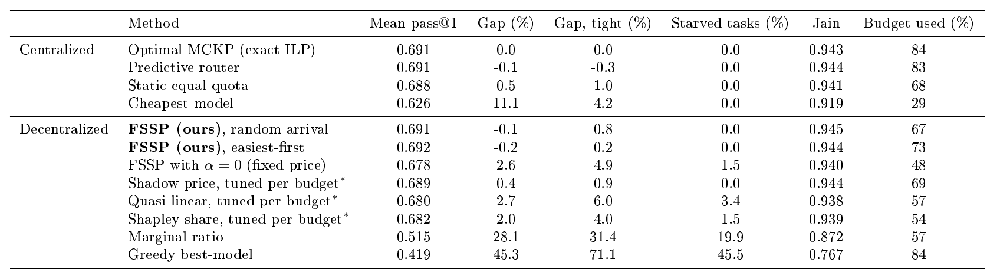
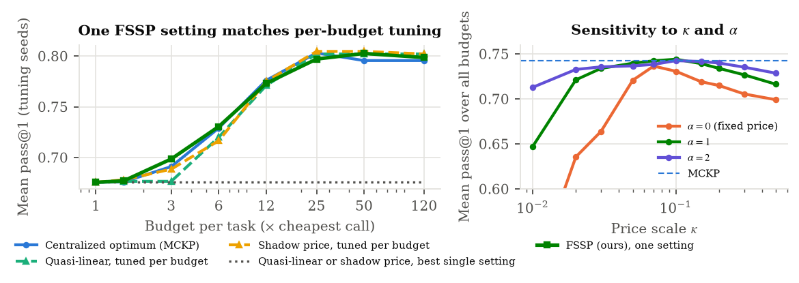
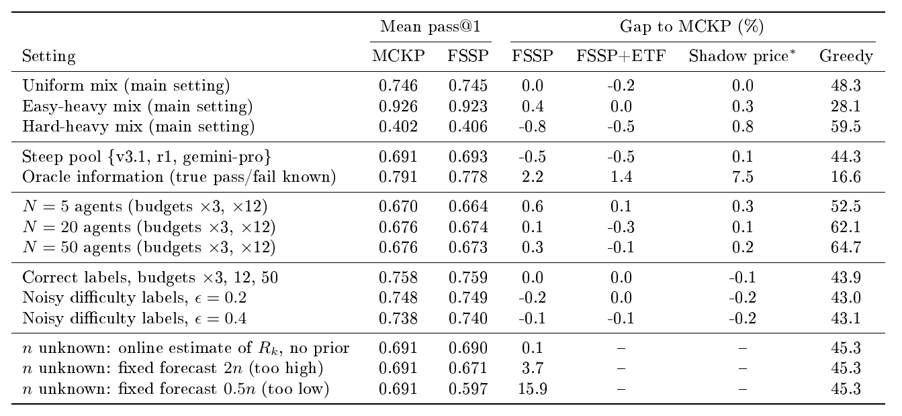

# masbudget

Experiment framework for **multi-agent model/API selection under a shared budget**
(see [project_proposal/project_proposal.tex](project_proposal/project_proposal.tex)).
It compares centralized allocation with the decentralized sequential resource-allocation game
on the same agents, models, costs and budget.

**Final paper:** [report/report.pdf](report/report.pdf) (source: [report/report.tex](report/report.tex)).
It proposes **Fair-Share Shadow Pricing (FSSP)**, a decentralized utility in which each arriving
agent prices money by the inverse of the budget still available per waiting request,
`p_k = κ · (n − k) / B_k`, and picks `argmax_m  q̂_m − p_k · c_m`. With one setting
(κ = 0.1, α = 1) it matches the exact centralized knapsack optimum on held-out data.
How to reproduce every number, plot and table in the paper is described in
[Reproducing the paper](#reproducing-the-paper) below.

## Reproduce

All results come from offline simulation on measured LLMRouterBench data. There are no API calls
and no keys are needed.

### 1. Setup

Tested with Python 3.12 on Windows 11 (12 cores): numpy 2.5, pandas 3.0, matplotlib 3.11,
ortools 9.15, PyYAML 6.0, pillow 12.3. To compile the paper and render table screenshots you also
need a LaTeX distribution with `pdflatex`, `bibtex` and `pdftoppm` (MiKTeX or TeX Live).

```bash
python -m venv .venv
.venv/Scripts/activate            # Linux/macOS: source .venv/bin/activate
pip install -r requirements.txt
python -m pytest -q               # 230 tests, all should pass
```

### 2. Run the experiments (from the repository root)

| Step | Command | What it does |
|---|---|---|
| 1 | `python scripts/hypotheses/run_all.py tune` | tunes the baseline utilities (λ, p₀, α), per budget level, on tuning seeds 1000–1019 |
| 2 | `python scripts/hypotheses/run_all.py main scale disparity noise` | design space: 5 centralized methods + 5 arrival orders × 5 utilities, 3 mixes × 8 budgets × 50 test seeds × {expected, oracle} information, plus agent count, model-pool and label-noise variants |
| 3 | `python scripts/hypotheses/burst_stage.py` | agents arrive in random order and submit all their tasks at once (first-mover test) |
| 4 | `python scripts/hypotheses/fssp_stage.py tune` | picks the **single** FSSP setting (κ, α) on the tuning seeds and writes `results/hypotheses/fssp_params.json` |
| 5 | `python scripts/hypotheses/fssp_stage.py test scale` | FSSP vs. all baselines on the 50 test seeds: 3 mixes × 8 budgets × 2 model pools × 2 information settings, and N ∈ {5, 10, 20, 50} |
| 6 | `python scripts/hypotheses/fssp_extra.py noise burst` | FSSP with noisy difficulty labels and agent-burst arrival |
| 6b | `python scripts/hypotheses/fssp_unknown_n.py` | FSSP when agents do **not** know the total number of requests n: online estimate of the remaining demand vs. wrong fixed forecasts |
| 7 | `python scripts/hypotheses/paper_figures.py` | writes the paper figures (`report/figures/*.pdf`), tables and numbers (`report/generated/*.tex`) and PNG copies (`figures/paper/`) |
| 8 | `python scripts/hypotheses/table_screenshots.py` | renders the generated tables as PNG (`figures/paper/table_*.png`) |
| 9 | `cd report && pdflatex report && bibtex report && pdflatex report && pdflatex report` | builds `report/report.pdf` |

\*Wall-clock on a 12-core laptop. Every run writes one row per (instance, policy) to
`results/hypotheses/<stage>.csv.gz`, 351,900 rows in total. The paper does not contain a single
hand-typed result. Every number in its Results section is a LaTeX macro in
`report/generated/numbers.tex`, and every table is a `.tex` file in `report/generated/`, all written
by `paper_figures.py` from those CSV files.

Code for the proposed method and the evaluation harness:

```
scripts/hypotheses/
  fair_share.py          FSSP utility (registered as "fair_share_price")
  harness.py             information models (expected / oracle), sampling, re-scoring, exact grouped MCKP
  run_all.py             baseline tuning + design-space stages
  burst_stage.py         "random agent burst" arrival order
  fssp_stage.py          FSSP tuning, test and scale stages
  fssp_extra.py          FSSP label-noise and burst stages
  fssp_unknown_n.py      FSSP with an estimated (unknown) number of requests
  paper_figures.py       figures, tables and numbers for the paper
  table_screenshots.py   PNG renders of the tables
  make_figures.py        figures for the earlier analysis in results.md
```

### 3. Results (screenshots)

**Quality vs. budget.** FSSP with one setting (green) lies on the centralized optimum (blue); greedy agents (orange) collapse.


**Main comparison** (expected-quality information, full model pool, mean over 3 mixes × 8 budgets × 50 test seeds; * = re-tuned for every budget).



**Design space**: gap to the optimum (%) for every arrival order × utility at tight budgets.


**One setting for every budget.** Left: baselines need per-budget tuning, FSSP does not. Right: sensitivity to κ and α.



**Robustness** of the single FSSP setting (mixes, steeper model pool, oracle information, 5–50 agents, noisy labels, unknown number of requests).



**Fairness**: agents arrive in random order with all their tasks.


**Model pool** (per-tier pass@1 and cost, from the dataset).


## How an experiment is set up

- You give a dataset of tasks and `num_agents` (N). Each agent gets
  floor(number of tasks / N) tasks, drawn without replacement (seeded).
- Every task is one model call that gets its own model, paid from the shared budget B.
- **Centralized:** a controller sees all tasks at once and assigns every model.
- **Decentralized:** tasks are served one at a time. With no coordinator
  (`arrival_policy: null`) the agents ask round-robin: agent 1 task 1, agent 2 task 1, ...,
  agent N task 1, agent 1 task 2, ... Each agent sees only the budget left when its turn comes.
- Quality is read from the dataset (no live API calls); costs come from the config.

## Setup

```bash
pip install -r requirements.txt
pip install ipykernel
```

## Run experiments

```bash
python -m masbudget configs/example.yaml                 # all experiments in the file
python -m masbudget configs/example.yaml --only NAME ... # a subset
python -m masbudget --list                               # registered factory names
```

Run from the repository root (dataset paths are resolved relative to it).

- `results/<experiment>_<timestamp>.json`: summary metrics + resolved config
- `logs/<experiment>_<timestamp>.log`: full log, including every agent's decision (DEBUG)

A failing experiment (e.g. one that uses a policy that is not implemented yet) is logged and
skipped; the rest of the batch still runs.

## Plot results

`masbudget.analysis.PolicyComparison`. It reads the newest result file of each experiment and
draws one bar chart per metric, one bar per policy:

```python
from masbudget.analysis import PolicyComparison

cmp = PolicyComparison.from_config("configs/all_individual_policy.yaml")
cmp = cmp.with_gap("central_optimal_mckp")   # optional: optimality_gap vs. a reference experiment
cmp.table(["average_quality", "total_cost"])  # policies x metrics
cmp.plot(["average_quality", "budget_utilization", "jains_fairness"], sort=True)
cmp.plot(["starvation_rate"], paradigms=["decentralized"])
```

## Tests

```bash
python -m pytest            # from the repo root
python -m pytest -rs        # also show why tests were skipped
```

Policy tests skip while a policy is still a stub (`NotImplementedError`) and start running as
soon as it is implemented. See [docs/extending.md](docs/extending.md#testing-your-policy).

## Use from Python

```python
from masbudget import AgentRegistry, ModelRegistry, load_dataset, run_experiment, get_metric

tasks = load_dataset("data/example_tasks.json")
agents = AgentRegistry.from_task_lists([tasks[0:5], tasks[5:10]])   # 2 agents x 5 tasks
models = ModelRegistry()
models.add("gpt-4o-mini", 0.01)
models.add("o1-reasoning", 0.25)

result = run_experiment(
    "optimal_mckp",        # centralized policy  (None = skip centralized)
    "quasi_linear",        # decentralized utility (None = skip decentralized)
    None,                  # arrival policy (None = uncoordinated FCFS, round-robin over agents)
    agents=agents, models=models, budget=0.5,
    utility_params={"lambda_cost": 0.5},
    metrics=["average_quality", "optimality_gap"],
)
print(result.metrics)
print(get_metric("jains_fairness").compute(result))   # any metric, after the fact
```

`Experiment(...)` gives the same thing as a class: `exp.run(metrics=[...])`, then `exp.evaluate([...])`.

## Layout

```
configs/                  experiment YAML files
data/                     datasets (JSON)
docs/                     config schema, dataset format, extension guide
notebooks/                result plots
logs/  results/           outputs
masbudget/
  core.py                 Task, Agent, Job, Assignment, RunResult, BudgetLedger, ...
  models.py               BaseModel + model factory (fallback: quality 0, cost 0)
  registry.py             AgentRegistry, ModelRegistry (shared by both paradigms)
  dataset.py              JSON loading / validation / dealing tasks to agents
  experiment.py           Experiment, run_experiment()
  config.py  runner.py    YAML loading, batch runs, results/logs
  analysis.py             load results/*.json, bar-plot policies per metric (PolicyComparison)
  centralized/            BaseCentralizedPolicy + one file per policy
  decentralized/
    sequential.py         the sequential best-response game (implemented)
    arrival/              BaseArrivalPolicy + one file per ordering policy
    utilities/            BaseUtilityFunction + one file per utility
  metrics/                BaseMetrics + metric implementations
tests/
  helpers.py              toy instance (4 tasks, 3 models; 4x1 or 2x2 agents), builders, brute-force optimum
  test_centralized.py     test_arrival.py  test_utilities.py   policy tests
  test_metrics.py         test_framework.py                    framework tests
```

## Docs

- [docs/config.md](docs/config.md): experiment YAML schema, how agents get tasks, metric definitions
- [docs/dataset.md](docs/dataset.md): dataset JSON format
- [docs/extending.md](docs/extending.md): adding models, policies, utilities, metrics
