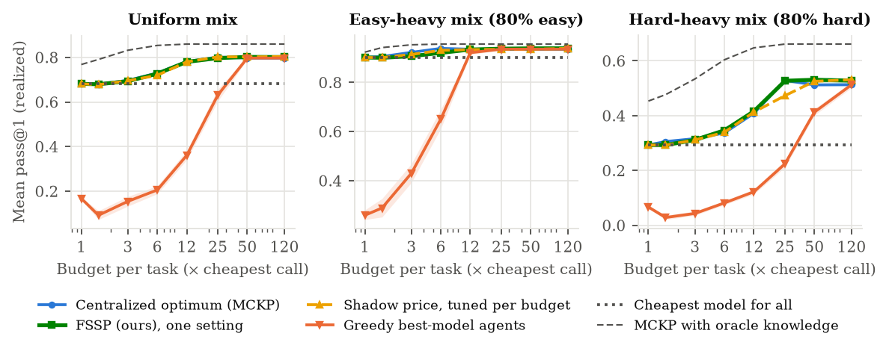
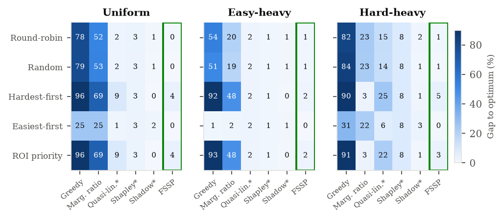
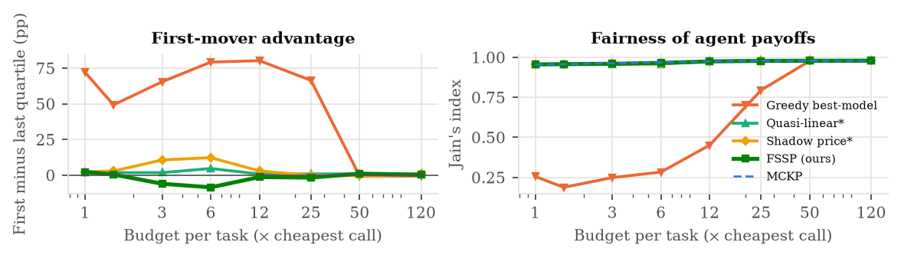
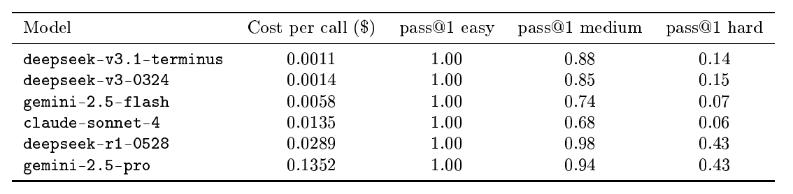

# MasBudget: Fair-Share Shadow Pricing for LLM Agents Sharing One Budget

Many AI agents can share **one API budget** and each pick its own LLM, **without a central controller**,
and still do as well as the best centralized plan.

- **Paper:** [report/report.pdf](report/report.pdf) (source: [report/report.tex](report/report.tex))
- **Full results and discussion:** [results.md](results.md)
- **Proposal:** [project_proposal/project_proposal.tex](project_proposal/project_proposal.tex)

Contents: [Problem](#1-problem) · [Methodology](#2-methodology-the-fssp-algorithm) ·
[Results](#3-results) · [Reproduce](#4-reproduce) · [Framework usage](#how-an-experiment-is-set-up)

---

## 1. Problem

- *N* agents each have tasks. Every task needs one LLM call.
- There are 6 models, from \$0.001 to \$0.135 per call. Expensive models are better only on hard tasks.
- All calls are paid from **one shared budget B**.

There are two ways to decide which model each task gets:

| | Centralized | Decentralized (our focus) |
|---|---|---|
| Who decides | one controller that sees all tasks | each agent, when its request arrives |
| How | solves a knapsack problem (MCKP), which is optimal | picks the model with the best utility for itself |
| Downside | must wait for all tasks; single point of control | greedy agents waste the budget |

**Question:** which utility should decentralized agents use so that they match the centralized optimum?

---

## 2. Methodology: the FSSP algorithm

### What we learned first

We tested 5 arrival orders × 5 utility functions on real data (1,055 coding tasks, 6 models, LLMRouterBench):

1. **Greedy agents fail.** They buy the most expensive model and lose **71 %** of the achievable quality at tight budgets.
2. **Agents must pay a price for money**, and that price must match the budget size. Existing price-based utilities
   work only if someone re-tunes the price for **every** budget.
3. **Arrival order matters much less than the utility.**

### Fair-Share Shadow Pricing (FSSP)

FSSP measures cost in units of the agent's **fair share**: the budget still left per request still to come.

```
fair share   f = B_k / R_k          B_k = remaining budget,  R_k = requests still to be served (incl. this one)
price        p = κ / f              κ = 0.1  (one setting for every budget)
choice       argmax over affordable models of   q̂_m − p · c_m
             q̂_m = agent's estimated chance that model m solves its task,  c_m = price of model m
```

In words: **upgrade to a more expensive model only if the gain in success probability is at least
0.1 for every extra fair share it costs.**

- When earlier agents overspent, the fair share shrinks, so the price rises.
- When earlier agents underspent, the price falls and later agents can upgrade.
- Because the price is relative to the budget, the same κ works for every budget size.

### Step by step (run by each agent, on its own)

When a request arrives:

1. **Read the shared ledger:** the remaining budget `B_k` and how many requests `k` came before this one.
   The ledger is just a counter, like a prepaid account balance. It never makes decisions.
2. **Estimate how many requests are still to come (`R_k`).**
   - If the total number of requests `n` is known: `R_k = n − k`.
   - In practice `n` is unknown. The budget covers a period (for example one month), and `t` is the
     fraction of it that has passed. So far `k + 1` requests have arrived, so:
     ```
     arrival rate     r = (k + 1) / t
     still to come    R_k = 1 + r · (1 − t)        (this request + the expected later ones)
     ```
     Optionally, start from a forecast `n0` with weight `w`: `r = (k + 1 + w·n0) / (t + w)`.
3. **Compute the price:** `f = B_k / R_k`, then `p = κ / f`.
4. **Pick a model:** the affordable model with the highest `q̂_m − p · c_m`. If none is affordable, the request gets no model.
5. **Pay:** `B_k` decreases by the model's cost.

No scheduler, no central solver and no knowledge of other agents' tasks are needed. Each decision is a
few arithmetic operations per model.

**Code:** [scripts/hypotheses/fair_share.py](scripts/hypotheses/fair_share.py) (known *n*),
[scripts/hypotheses/fssp_unknown_n.py](scripts/hypotheses/fssp_unknown_n.py) (unknown *n*).

### How we evaluated it

- κ was chosen **once** on 20 tuning seeds. All results below use 50 different test seeds.
- Agents see only the estimated success rate of each model on the task's difficulty level, not the real outcome.
- Compared against 5 centralized methods (including the exact optimum, MCKP) and the other decentralized utilities.
- Settings: 3 task mixes, 8 budget levels, 2 model pools, 5–50 agents, noisy labels and unknown *n*.
  In total there are 351,900 simulated runs.

---

## 3. Results

**Key numbers** (mean pass@1, i.e. the share of tasks solved):

| Method | Pass@1 | Gap to optimum | Tasks with no model |
|---|---|---|---|
| Centralized optimum (MCKP) | 0.691 | 0 % | 0 % |
| **FSSP (ours), random arrival** | **0.691** | **−0.1 %** | **0 %** |
| **FSSP, number of requests unknown** | **0.690** | **0.1 %** | **0.1 %** |
| Shadow price, re-tuned for every budget | 0.689 | 0.4 % | 0 % |
| Greedy agents | 0.419 | 45.3 % | 45.5 % |

- FSSP matches the centralized optimum with **one** parameter setting.
- Arrival order barely matters (gap between −0.2 % and 1.4 % over 5 orders). Plain random arrival needs no scheduler and is already at the optimum.
- It stays within about 1 % of the optimum across task mixes, model pools, 5–50 agents and noisy labels.
- It is as fair as the central planner (Jain index 0.96). Greedy agents give almost everything to whoever arrives first.

### Plots and tables

**Quality vs. budget.** FSSP (green) lies on the optimum (blue). Greedy agents (orange) collapse.



**Main comparison** (\* = re-tuned for every budget).


**Design space:** gap to the optimum (%) for every arrival order × utility, at tight budgets.



**One setting for every budget.** Left: the baselines need per-budget tuning, FSSP does not. Right: FSSP is
insensitive to κ.


**Robustness**, including the unknown number of requests (last rows).


**Fairness:** agents arrive in random order with all their tasks.



**Model pool** (cost and pass@1 per difficulty level).



---

## 4. Reproduce

All results come from offline simulation on recorded benchmark data. No API calls or keys are needed.

### Setup

Tested with Python 3.12 on Windows 11. To build the paper and the table images you also need LaTeX
(`pdflatex`, `bibtex`, `pdftoppm`, from MiKTeX or TeX Live).

```bash
python -m venv .venv
.venv/Scripts/activate            # Linux/macOS: source .venv/bin/activate
pip install -r requirements.txt
python -m pytest -q               # 230 tests, all should pass
```

### Run (from the repository root, in this order)

```bash
# 1. baselines: tune, then run the full design space
python scripts/hypotheses/run_all.py tune
python scripts/hypotheses/run_all.py main scale disparity noise
python scripts/hypotheses/burst_stage.py

# 2. FSSP: pick the one setting, then test it
python scripts/hypotheses/fssp_stage.py tune
python scripts/hypotheses/fssp_stage.py test scale
python scripts/hypotheses/fssp_extra.py noise burst
python scripts/hypotheses/fssp_unknown_n.py

# 3. figures, tables and the paper
python scripts/hypotheses/paper_figures.py
python scripts/hypotheses/table_screenshots.py
cd report && pdflatex report && bibtex report && pdflatex report && pdflatex report
```

| Script | What it does |
|---|---|
| `run_all.py tune` | tunes the baseline utilities separately for each budget |
| `run_all.py main scale disparity noise` | all centralized methods + all arrival × utility pairs, plus agent-count, model-pool and label-noise variants |
| `burst_stage.py` | agents arrive with all their tasks at once (fairness test) |
| `fssp_stage.py tune` | picks the single FSSP setting → `results/hypotheses/fssp_params.json` |
| `fssp_stage.py test scale` | FSSP vs. all baselines on the test seeds, and for 5–50 agents |
| `fssp_extra.py noise burst` | FSSP with noisy difficulty labels and burst arrival |
| `fssp_unknown_n.py` | FSSP when the number of requests is unknown |
| `paper_figures.py` | paper figures, tables and numbers (`report/figures/`, `report/generated/`, `figures/paper/`) |
| `table_screenshots.py` | table images for this README (`figures/paper/table_*.png`) |

Every run is saved as one row in `results/hypotheses/<stage>.csv.gz`. No number in the paper is typed
by hand: all of them are generated from these files.

### Code layout

```
scripts/hypotheses/
  fair_share.py          FSSP utility
  fssp_unknown_n.py      FSSP with an estimated number of requests
  harness.py             what agents know, instance sampling, scoring, exact MCKP solver
  run_all.py             baseline tuning and design-space experiments
  burst_stage.py         "all tasks at once" arrival order
  fssp_stage.py          FSSP tuning and test experiments
  fssp_extra.py          FSSP noise and burst experiments
  paper_figures.py       figures, tables and numbers for the paper
  table_screenshots.py   table images
  make_figures.py        figures for results.md
```

---

# Framework usage

The sections below describe the general `masbudget` framework that the experiments are built on.

## How an experiment is set up

- You give a dataset of tasks and `num_agents` (N). Each agent gets
  floor(number of tasks / N) tasks, drawn without replacement (seeded).
- Every task is one model call that gets its own model, paid from the shared budget B.
- **Centralized:** a controller sees all tasks at once and assigns every model.
- **Decentralized:** tasks are served one at a time. With no coordinator
  (`arrival_policy: null`) the agents ask round-robin: agent 1 task 1, agent 2 task 1, ...,
  agent N task 1, agent 1 task 2, ... Each agent sees only the budget left when its turn comes.
- Quality is read from the dataset (no live API calls); costs come from the config.

## Setup

```bash
pip install -r requirements.txt
pip install ipykernel
```

## Run experiments

```bash
python -m masbudget configs/example.yaml                 # all experiments in the file
python -m masbudget configs/example.yaml --only NAME ... # a subset
python -m masbudget --list                               # registered factory names
```

Run from the repository root (dataset paths are resolved relative to it).

- `results/<experiment>_<timestamp>.json`: summary metrics + resolved config
- `logs/<experiment>_<timestamp>.log`: full log, including every agent's decision (DEBUG)

A failing experiment (e.g. one that uses a policy that is not implemented yet) is logged and
skipped; the rest of the batch still runs.

## Plot results

`masbudget.analysis.PolicyComparison`. It reads the newest result file of each experiment and
draws one bar chart per metric, one bar per policy:

```python
from masbudget.analysis import PolicyComparison

cmp = PolicyComparison.from_config("configs/all_individual_policy.yaml")
cmp = cmp.with_gap("central_optimal_mckp")   # optional: optimality_gap vs. a reference experiment
cmp.table(["average_quality", "total_cost"])  # policies x metrics
cmp.plot(["average_quality", "budget_utilization", "jains_fairness"], sort=True)
cmp.plot(["starvation_rate"], paradigms=["decentralized"])
```

## Tests

```bash
python -m pytest            # from the repo root
python -m pytest -rs        # also show why tests were skipped
```

Policy tests skip while a policy is still a stub (`NotImplementedError`) and start running as
soon as it is implemented. See [docs/extending.md](docs/extending.md#testing-your-policy).

## Use from Python

```python
from masbudget import AgentRegistry, ModelRegistry, load_dataset, run_experiment, get_metric

tasks = load_dataset("data/example_tasks.json")
agents = AgentRegistry.from_task_lists([tasks[0:5], tasks[5:10]])   # 2 agents x 5 tasks
models = ModelRegistry()
models.add("gpt-4o-mini", 0.01)
models.add("o1-reasoning", 0.25)

result = run_experiment(
    "optimal_mckp",        # centralized policy  (None = skip centralized)
    "quasi_linear",        # decentralized utility (None = skip decentralized)
    None,                  # arrival policy (None = uncoordinated FCFS, round-robin over agents)
    agents=agents, models=models, budget=0.5,
    utility_params={"lambda_cost": 0.5},
    metrics=["average_quality", "optimality_gap"],
)
print(result.metrics)
print(get_metric("jains_fairness").compute(result))   # any metric, after the fact
```

`Experiment(...)` gives the same thing as a class: `exp.run(metrics=[...])`, then `exp.evaluate([...])`.

## Layout

```
configs/                  experiment YAML files
data/                     datasets (JSON)
docs/                     config schema, dataset format, extension guide
notebooks/                result plots
logs/  results/           outputs
masbudget/
  core.py                 Task, Agent, Job, Assignment, RunResult, BudgetLedger, ...
  models.py               BaseModel + model factory (fallback: quality 0, cost 0)
  registry.py             AgentRegistry, ModelRegistry (shared by both paradigms)
  dataset.py              JSON loading / validation / dealing tasks to agents
  experiment.py           Experiment, run_experiment()
  config.py  runner.py    YAML loading, batch runs, results/logs
  analysis.py             load results/*.json, bar-plot policies per metric (PolicyComparison)
  centralized/            BaseCentralizedPolicy + one file per policy
  decentralized/
    sequential.py         the sequential best-response game (implemented)
    arrival/              BaseArrivalPolicy + one file per ordering policy
    utilities/            BaseUtilityFunction + one file per utility
  metrics/                BaseMetrics + metric implementations
tests/
  helpers.py              toy instance (4 tasks, 3 models; 4x1 or 2x2 agents), builders, brute-force optimum
  test_centralized.py     test_arrival.py  test_utilities.py   policy tests
  test_metrics.py         test_framework.py                    framework tests
```

## Docs

- [docs/config.md](docs/config.md): experiment YAML schema, how agents get tasks, metric definitions
- [docs/dataset.md](docs/dataset.md): dataset JSON format
- [docs/extending.md](docs/extending.md): adding models, policies, utilities, metrics
