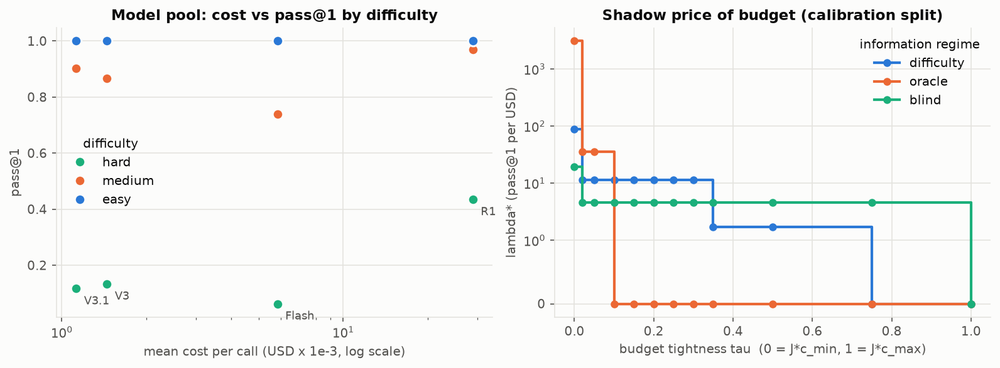

# E1 - Benchmark profile

**Question.** What does the allocation problem look like on the real data, before any policy runs?

**Setup.** `data/llmrouterbench_livecodebench.json`: 1,055 LiveCodeBench tasks × 4 models, binary pass@1,
measured mean cost per call. The tasks are split once, stratified by difficulty, into a **calibration split**
(317 tasks: estimates q̂, tunes parameters, calibrates prices) and an **evaluation split** (738 tasks: all
reported numbers). Script: `e01_data_profile.py`. Notebook: `notebooks/01_benchmark_profile.ipynb`.

## Results

| model | cost (USD) | × cheapest | pass@1 | easy | medium | hard | dominated |
|---|---|---|---|---|---|---|---|
| DeepSeek-V3.1-Terminus | 0.00112 | 1.0 | 0.673 | 1.000 | 0.903 | 0.117 | no |
| DeepSeek-V3-0324 | 0.00145 | 1.3 | 0.666 | 1.000 | 0.867 | 0.134 | yes |
| Gemini-2.5-Flash | 0.00583 | 5.2 | 0.600 | 1.000 | 0.739 | 0.063 | yes |
| DeepSeek-R1-0528 | 0.02887 | 25.7 | 0.801 | 1.000 | 0.969 | 0.435 | no |

* **Outcome structure.** All 351 easy tasks are solved by every model. 186 of 352 "medium" tasks are also solved by
  every model (the tertile split breaks ties by index). 178 hard tasks are solved by no model. An oracle that
  calls the cheapest passing model reaches 0.831 pass@1 for $0.0031/task. R1 everywhere gives 0.801 for $0.0289/task.
* **Information matters.** The dataset's `quality` is the *realized* outcome. An agent that "knows q_{i,m}"
  therefore knows in advance whether its call will pass, and `best_model` then simply picks the cheapest passing
  model. To study the proposal's tragedy of the commons realistically, we add an **expected-quality
  (difficulty) regime**: q̂ = calibration pass rate of the model on tasks with the same difficulty label.
  Outcomes are still scored on the realized pass/fail.

Calibrated q̂ (difficulty regime):

| label | V3.1 | V3 | Flash | R1 |
|---|---|---|---|---|
| easy | 1.000 | 1.000 | 1.000 | 1.000 |
| medium | 0.887 | 0.915 | 0.755 | 0.962 |
| hard | 0.104 | 0.094 | 0.085 | 0.425 |
| blind (all) | 0.662 | 0.669 | 0.612 | 0.795 |

Upgrade values: hard V3.1→R1 gains 0.32 for $0.0277 (**11.6 pass@1/$**). Medium V3.1→V3 is 87/$ (but tiny),
and medium V3.1→R1 is 2.7/$ (V3→R1: **1.7/$**).

**Shadow price of budget λ\*(τ)** (Lagrangian price of the MCKP relaxation, calibration split, budget
B = J·c_min + τ·J·(c_max − c_min)):

| τ | 0 | 0.02–0.30 | 0.35–0.5 | ≥ 0.75 |
|---|---|---|---|---|
| λ\* difficulty regime | 87.9 | **11.56** | 1.72 | 0 |
| λ\* oracle regime | 3104 | 36 (τ ≤ 0.05), then 0 | 0 | 0 |

## Takeaways

1. The pool has a cheap tier (V3.1) and a frontier tier (R1, 25.7× the cost). Flash and V3 are dominated on average.
2. In the difficulty regime λ\* is a **step function**: across the moderate budgets it sits exactly at the ROI of
   upgrading a hard task. At that price every hard task is *indifferent*, so a single posted price can buy R1
   for all hard tasks or for none, never the right fraction. This predicts that static prices fail and
   time-varying (paced) prices succeed. E4 and E5 confirm it.
3. In the oracle regime the budget binds only when it is very tight (τ < 0.1). Contention there is mild.
