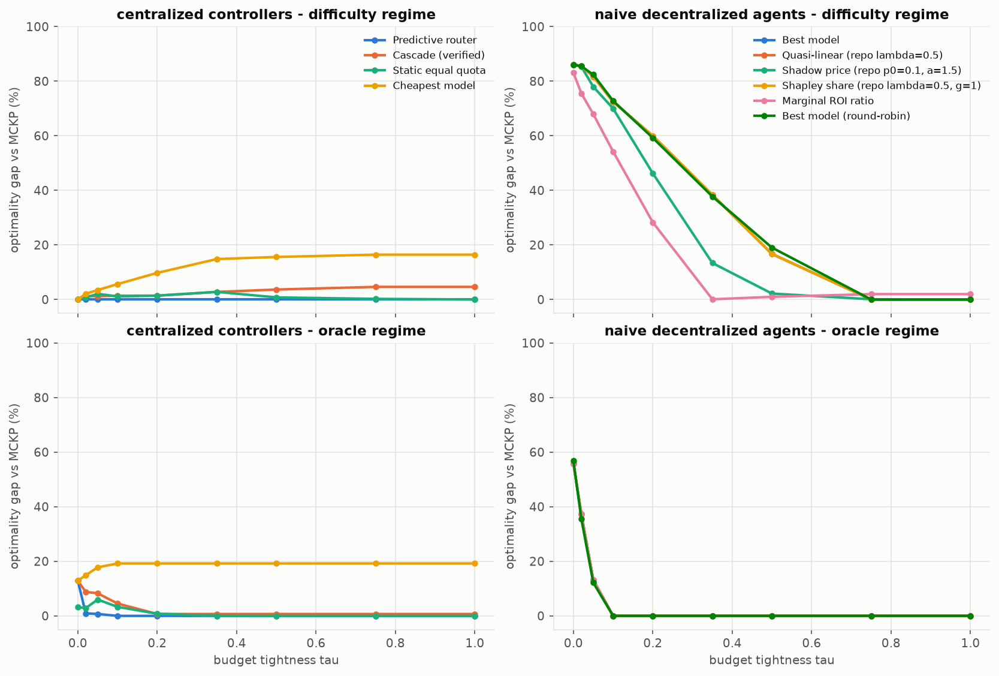

# E2 - Price of anarchy: centralized controllers vs. naive decentralized agents

**Question (RQ1).** How large is the gap between uncoordinated sequential model choice and the centralized
MCKP optimum, across budget pressure?

**Setup.** N = 20 agents × 10 tasks (J = 200 jobs), uniform difficulty mix, measured costs, 9 budget levels
τ ∈ {0 … 1}. 20 task samples (instances) × 10 random arrival permutations; both information regimes.
Centralized: MCKP (OR-Tools), predictive router, verified cascade (escalates on the real unit-test outcome),
static equal quota, cheapest model. Decentralized: `best_model` and the repo-default utilities (λ = 0.5,
p0 = 0.1/α = 1.5, Shapley λ = 0.5/γ = 1, marginal ROI). Gap = (SW_MCKP − SW)/SW_MCKP on expected quality,
paired per instance. 20,160 runs. Script: `e02_price_of_anarchy.py`.
Notebook: `notebooks/02_price_of_anarchy_and_ordering.ipynb`.

## Results (difficulty regime, moderate budget τ = 0.2, mean over 20 instances; 95% CI ≤ ±0.02)

| policy | q̂ | realized pass@1 | gap | tasks starved | Jain (agents) | pass@1 easy / medium / hard |
|---|---|---|---|---|---|---|
| MCKP (optimal) | 0.738 | 0.726 | 0 | 0 | 0.965 | 1.00 / 0.85 / 0.33 |
| Predictive router | 0.738 | 0.718 | 0.000 | 0 | 0.964 | 1.00 / 0.85 / 0.30 |
| Static equal quota | 0.728 | 0.736 | 0.014 | 0 | 0.962 | 1.00 / 0.90 / 0.31 |
| Cascade (verified) | 0.728 | **0.782** | 0.014 | 0 | 0.974 | 1.00 / 1.00 / 0.35 |
| Cheapest model | 0.666 | 0.676 | 0.098 | 0 | 0.957 | 1.00 / 0.90 / 0.12 |
| Marginal ROI ratio | 0.530 | 0.519 | 0.283 | 0.31 | 0.916 | 0.68 / 0.58 / 0.29 |
| Shadow price (repo params) | 0.397 | 0.396 | 0.462 | 0.47 | 0.872 | 0.52 / 0.48 / 0.19 |
| Best model / quasi-linear λ=0.5 / Shapley (repo) | 0.296 | 0.297 | **0.600** | **0.62** | 0.812 | 0.37 / 0.36 / 0.16 |

Gap of `best_model` over budgets (difficulty regime): τ = 0: 86% · 0.05: 82% · 0.2: 60% · 0.5: 17% · ≥ 0.75: 0%.
In the oracle regime: τ = 0: 56% · 0.05: 13% · ≥ 0.1: 0%.

## Takeaways

1. **The tragedy of the commons is large and real.** Agents that buy their best affordable model exhaust the
   budget on R1 for the first ~40% of arrivals. The remaining 62% of tasks starve, including easy tasks any
   model would have solved (easy pass@1 drops from 1.00 to 0.37). The price of anarchy is 60% at moderate
   budgets and 86% at severe ones, and shrinks to 0 only when B ≥ the cost of everyone's best model.
2. **The repo-default utility parameters are on the wrong scale.** Costs are about 10⁻³ USD, so λ·c with
   λ = 0.5 is about 10⁻³ and the quasi-linear and Shapley agents behave exactly like `best_model`. Utilities must
   be parameterized in quality-per-dollar (λ\* ≈ 11.6, E1). E4 tunes them properly.
3. Round-robin and random arrival give the same mean gap. Random has much higher variance (E3).
4. Every centralized controller is within 1.4% of MCKP on expected quality. The **verified cascade beats MCKP on
   realized pass@1** (+5.6 points) because unit-test verification reveals per-task information that q̂ lacks.
   Coordination is not the only lever: information matters too (E7).
5. In the oracle regime, MCKP "starves" 16–22% of tasks on purpose: hopeless tasks get no call, which is free.
   Starvation rates of centralized policies should be read with that in mind.
