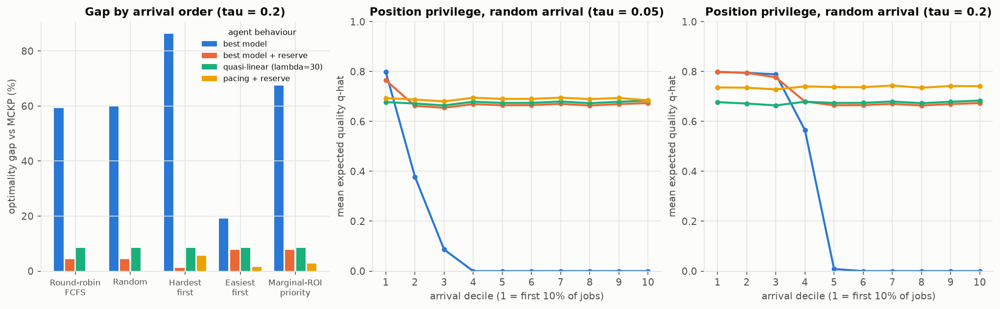

# E3 - Arrival ordering and position privilege

**Questions (RQ2, RQ3).** How much does the arrival order π distort outcomes (first-mover advantage,
starvation)? Can a lightweight queue policy (hardest-first, marginal-ROI priority) close the gap on its own?

**Setup.** Difficulty regime, uniform mix, measured costs, τ ∈ {0, 0.05, 0.2, 0.5}, 20 instances × 10
permutations. Five arrival policies (round-robin FCFS, random, hardest-first, easiest-first, marginal-ROI
priority) × four agent behaviours (best model; best model + reserve; quasi-linear λ = 30, tuned without
reserve in E4; pacing + reserve, the E5 mechanism with β = 5). Main grid N = 20 × 10 tasks. A proposal-faithful
grid uses N = 50 agents × 1 task. The **reserve** is a ledger rule added to the engine
(`decentralized.params.reserve`): a call may not leave less than c_min for each job still waiting.
Script: `e03_arrival_ordering.py`.

## Results: gap to MCKP (%), N = 20 × 10, τ = 0.2

| arrival \ behaviour | best model | best model + reserve | quasi-linear λ=30 | pacing + reserve |
|---|---|---|---|---|
| Round-robin FCFS | 59.2 | 4.3 | 8.5 | **0.1** |
| Random | 60.0 | 4.4 | 8.5 | **0.1** |
| Hardest first | **86.4** | **1.1** | 8.5 | 5.6 |
| Easiest first | 19.2 | 7.7 | 8.5 | 1.5 |
| Marginal-ROI priority | 67.5 | 7.7 | 8.5 | 2.8 |

Position privilege and stability (random arrival, τ = 0.2):

| behaviour | first-mover ratio (first / last quartile of jobs) | SD of welfare across permutations | tasks starved |
|---|---|---|---|
| best model | ∞ (last quartile starves) | 2.76 | 62% |
| best model + reserve | 1.20 | 0.56 | 0 |
| pacing + reserve | **1.00** | **0.14** | 0 |

With 1 task per agent (N = 50, τ = 0.2): random + best model has gap 50%, Jain 0.41, and 52% of agents starve.
Random + pacing + reserve has gap 0.0%, Jain 0.84 (equal to MCKP's 0.84), first-mover ratio 1.05.

## Takeaways

1. **Position privilege is extreme without coordination.** Under random arrival the first three deciles of
   greedy agents get q̂ ≈ 0.8 and everyone after decile 5 gets nothing. Who wins depends on arrival luck, and
   welfare varies widely across permutations.
2. **A queue policy alone does not fix it and can make it worse.** Hardest-first with greedy agents is the worst
   cell (86%): hard tasks drain the budget on R1 and the easy tasks queued behind them starve. Marginal-ROI
   priority promotes *medium* tasks first (V3's tiny but cheap upgrade has the highest ROI), and those agents
   then buy R1 anyway.
3. **Ordering + a budget floor works.** Hardest-first + reserve reaches 1.1% (0.4% with 1 task per agent). This
   confirms the proposal's HTF hypothesis, but only once starvation is ruled out.
4. **Pacing needs uncoordinated arrivals.** The pacing price assumes spending is spread over time. Random and
   round-robin arrivals satisfy this (0.1% gap); sorted queues do not (1.5–5.6%). Use a coordinator's sorted
   queue *or* a pacing price, not both.
