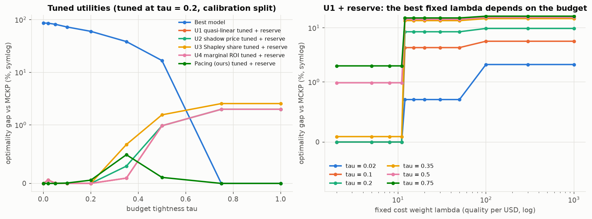

# E4 - Utility design (U1–U4 and the pacing price)

**Question (RQ4).** Can the agents' local utility make selfish best responses approach the centralized
optimum? Which formulation is robust across budgets?

**Setup.** Difficulty regime, uniform mix, N = 20 × 10, random arrival.
* **Phase A, tuning** (calibration split, τ = 0.2, 10 instances × 5 permutations): grid search of every
  utility, with and without the reserve. U1 quasi-linear λ ∈ [0.5, 300]; U2 shadow price p0 × α (35
  settings); U3 Shapley share λ × γ with the original characteristic function and an `upgrade_gain` variant;
  U4 marginal ROI ratio; and the new **`budget_pacing`** utility,
  U = q − p_k·c with p_k = p0·exp(β·(spent share − elapsed share)), p0 = λ\* of the calibration split at the
  same budget per job (β grid).
* **Phase B, evaluation** (evaluation split, all 9 budgets, 20 × 10): tuned settings vs. repo defaults.
* **Phase C**: fixed λ swept at every budget.

Script: `e04_utility_design.py`. Notebook: `notebooks/03_mechanism_design.ipynb`.

## Results

Phase A selections (τ = 0.2, calibration split):

| utility | no reserve: best setting → gap | with reserve: best setting → gap |
|---|---|---|
| U1 quasi-linear | λ = 30 → 8.5% | λ ∈ [2, 11] → 0.0% |
| U2 shadow price | p0 = 5, α = 0.5 → 0.9% | p0 = 3, α = 0.5 → 0.0% |
| U3 Shapley share | λ = 100, γ = 1 → 1.8% | upgrade_gain, λ = 30, γ = 20 → 0.0% |
| U4 marginal ROI | → 28.1% | → 0.0% |
| Pacing (ours) | β ∈ [0.5, 20] → 0.04% | β ∈ [0.5, 20] → 0.04% (β = 0: 8.5%) |

Phase B, gap to MCKP (%) on the evaluation split, parameters tuned at τ = 0.2:

| policy | τ=0 | 0.05 | 0.2 | 0.35 | 0.5 | 1.0 | **worst** |
|---|---|---|---|---|---|---|---|
| Best model (= all repo defaults) | 86.1 | 81.7 | 60.0 | 38.3 | 16.7 | 0 | 86.1 |
| U1 tuned (λ = 30) | 7.7 | 2.1 | 8.5 | 13.6 | 14.4 | 15.3 | 15.3 |
| U2 tuned | 76.2 | 45.2 | 0.9 | 2.0 | 1.0 | 2.0 | 76.2 |
| U3 tuned | 69.6 | 40.5 | 3.0 | 8.4 | 9.3 | 10.2 | 69.6 |
| U4 marginal ROI | 83.1 | 68.0 | 28.3 | 0.1 | 1.0 | 2.0 | 83.1 |
| U1 / U2 / U4 tuned + reserve | 0 | 0.0 | 0.0 | 0.1–0.3 | 1.0 | 2.0 | 2.0 |
| U3 tuned + reserve | 0 | 0.0 | 0.0 | 0.7 | 1.6 | 2.5 | 2.5 |
| **Pacing (ours)** | 0 | 0 | 0.1 | 1.2 | 0.1 | 0 | **1.2** |
| **Pacing (ours) + reserve** | 0 | 0 | 0.1 | 0.5 | 0.1 | 0 | **0.5** |

Phase C: with the reserve, a fixed λ is within 2% everywhere only inside the window λ ∈ [2, 11]. That window
lies between the two class ROIs (1.7 and 11.6 pass@1/$, E1). λ ≥ 12 loses 2–15%. Without the reserve, any
λ ≤ 11 loses 29–84% at tight budgets.

(Left panel: the U1, U2 and U4 + reserve lines coincide.)

## Takeaways

1. **Starvation dominates the price of anarchy.** Once the reserve rules out starvation, every sensible utility
   is within ~2% of optimal on this coarse-information problem. Without it, all fixed-parameter utilities tuned
   at one budget collapse at tighter budgets (70–83% gap).
2. **A fixed λ is only right inside a window set by the ROI structure.** The window moves whenever prices or the
   task mix change (E5, E6).
3. **The pacing price is the only utility that is near-optimal at every budget *without* the reserve**
   (worst 1.2%, insensitive to β ∈ [0.5, 20]). As predicted in E1, its β = 0 version, a static posted price at
   λ\*, fails (8.5%) because of the indifference at λ\*. Feedback lets the price oscillate around λ\* and buy
   R1 for exactly the right share of hard tasks.
4. The original Shapley characteristic v(S) = max_m Σq − c_m gives a *larger* φ_i to agents with *easier*
   tasks (higher q), the opposite of the proposal's intent. The `upgrade_gain` variant fixes the direction, but
   Shapley weighting adds nothing over a correctly scaled price.
