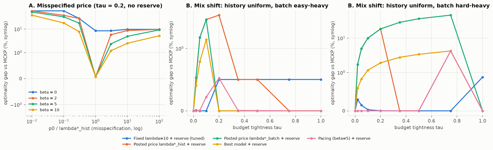

# E5 - Robustness of the pacing mechanism (and selection of the final version)

**Question.** The pacing agents need a reference price p0, the job horizon J and a history to calibrate on.
How badly do errors in each hurt, and how should the mechanism be set?

**Setup.** Difficulty regime, N = 20 × 10, random arrival, 10–20 instances × 5–10 permutations.
* **A.** p0 = s·λ\*_hist with s ∈ [0.01, 100], β ∈ {0, 2, 5, 10}, ± reserve, τ ∈ {0.05, 0.2, 0.5}.
* **B.** Mix shift: prices learned on the (uniform) calibration history, deployed on easy-heavy (80/10/10)
  and hard-heavy (10/10/80) batches, against fixed-λ agents and a posted price with *in-batch* λ\*.
* **C.** Agents assume a horizon of s·J, s ∈ {0.5, 0.8, 1, 1.25, 2}.
* **D.** Price floor p_min = f/(c_max − c_min), f ∈ [0, 0.2], × β ∈ {5, 10}, ± reserve, every mix × 9 budgets.
  The setting is **selected on the calibration split** (N = 10 × 10) and reported on the evaluation split.

Scripts: `e05_pacing_robustness.py`, `e05d_price_floor.py`.

## Results

**A. Misspecified p0** (gap %, τ = 0.2):

| p0 / λ\* | β=0 | β=2 | β=5 | β=10 | β=10 + reserve |
|---|---|---|---|---|---|
| 0.01 | 60.2 | 60.2 | 53.4 | 39.4 | 1.8 |
| 0.3 | 28.7 | 28.7 | 18.1 | 7.9 | 0.0 |
| 1 | 8.5 | 0.07 | 0.07 | 0.07 | 0.07 |
| 10 | 9.8 | 8.7 | 5.0 | 2.5 | 2.5 |
| 100 | 9.8 | 9.8 | 9.3 | 5.2 | 5.2 |

**B. Mix shift** (worst gap over 9 budgets, %):

| policy | easy-heavy | uniform | hard-heavy |
|---|---|---|---|
| Fixed λ = 30 (tuned, no reserve) | 3.9 | 15.3 | 48.8 |
| Posted price λ\*_hist (β = 0) | 3.9 | 8.5 | 34.1 |
| Posted price λ\*_batch + reserve (knows the batch) | 3.3 | 8.5 | 46.5 |
| Best model + reserve | 1.4 | 6.0 | 4.3 |
| Fixed λ = 10 + reserve (tuned) | 0.5 | 2.0 | 0.9 |
| Pacing (β = 5) + reserve, no floor | 0.5 | 0.5 | **4.3** (τ = 0.75) |

**C. Horizon** (gap %, τ = 0.05 / 0.2 / 0.5): ×0.5 → 41 / 28 / 16 without reserve, **0 / 0 / 3.0 with
reserve**. ×1.25 → 0.7 / 2.1 / 0.6. ×2 → 1.9 / 5.1 / 1.0.

**D. Price floor** (worst gap over all 27 mix × budget cells, %):

| setting (reserve on) | calibration split | evaluation split | mean (eval) |
|---|---|---|---|
| no floor, β = 5 | 4.3 | 4.3 | 0.21 |
| **floor 0.1, β = 10 (selected)** | **0.39** | **0.36** | **0.08** |
| floor 0.05, β = 10 | 0.96 | 0.39 | 0.05 |
| floor 0.1, β = 10, *no reserve* | — | 2.7 | 0.62 |

## Takeaways

1. **Static prices fail even when computed perfectly.** A posted price equal to the batch's own λ\* loses up to
   47%: at λ\* the marginal class is indifferent and ties resolve to "nobody upgrades". Feedback (β > 0) is
   what implements the fractional optimum.
2. The feedback corrects **over-pricing** reasonably well and under-pricing poorly (overspending happens before
   the price catches up). The **reserve covers the dangerous side**: with it, p0 can be off by 100× in
   either direction for ≤ 5% loss, and underestimating J by 2× costs ≤ 3%.
3. **A multiplicative price stuck at 0 cannot react.** When history says the budget is slack (λ\*_hist = 0)
   but the batch is hard-heavy, unfloored pacing degenerates to best-model + reserve (4.3%). A small floor,
   0.1/(c_max − c_min) (the price at which one full quality point is worth exactly the premium-over-cheapest
   cost), removes this failure.
4. **Final mechanism ("Pacing + reserve (ours)")**: U = q − p_k·c, p_k = max(λ\*_hist, p_min)·exp(10·(s_k − k/J)),
   ledger reserve on. Worst-case gap 0.36% over every mix and budget. E8 shows that λ\*_hist can even be dropped.
