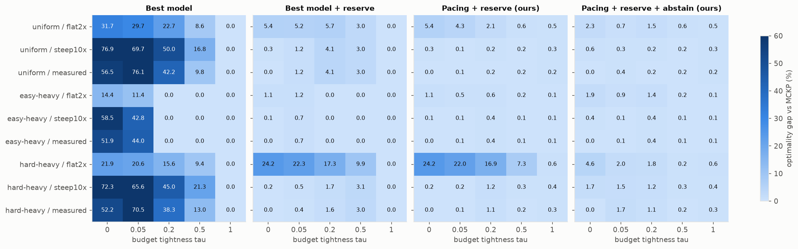

# E6 - Full factorial: agents × difficulty mix × budget × cost disparity

**Question (RQ5, and sub-questions 1–5 of the proposal).** Under which combinations of task mix, budget and
pricing does decentralized choice fail catastrophically, and where is it near-optimal? Does the mechanism
hold across all of them?

**Setup.** N ∈ {5, 10, 20, 50} agents × 5 tasks; mixes uniform / easy-heavy (80/10/10) / hard-heavy
(10/10/80); τ ∈ {0, 0.05, 0.2, 0.5, 1}; cost disparity **flat** (R1 = 2× cheapest), **steep** (10×),
**measured** (25.7×), with intermediate costs rescaled keeping their order. 180 cells × 10 instances × 5
permutations. Difficulty regime, random arrival. Fixed-parameter utilities keep their E4 values (tuned under
measured pricing, uniform mix), so the other cells test transfer. Two extra references: **MCKP (serve all)**,
the optimum among allocations that give every job a model, and an **abstain** option for the pacing agents
(`decentralized.params.abstain`: an agent may decline its call when every model's utility is negative).
Scripts: `e06_factorial.py`, `e06b_no_history.py`.

## Results (gap to MCKP, %, over the 180 cells)

| policy | mean | worst | cells > 5% | gap to serve-all MCKP (mean) | tasks starved |
|---|---|---|---|---|---|
| **Pacing + reserve + abstain (ours)** | **0.71** | 6.8 | 1.7% | −1.48 | 5.1% |
| Static equal quota (centralized) | 1.51 | 7.3 | 9.4% | −0.66 | 3.1% |
| MCKP (serve all) | 1.85 | 24.5 | 10.6% | 0 | 0 |
| Predictive router (centralized) | 1.96 | 24.5 | 10.6% | 0.11 | 0 |
| **Pacing + reserve (ours)** | **2.08** | 24.5 | 10.6% | **0.23** | 0 |
| U1 quasi-linear λ=10 + reserve | 2.42 | 24.5 | 14.4% | 0.58 | 0 |
| U2 shadow price + reserve | 2.52 | 24.5 | 14.4% | 0.68 | 0 |
| Best model + reserve | 2.76 | 24.5 | 14.4% | 0.93 | 0 |
| Cascade (verified, centralized) | 4.69 | 25.4 | 25.6% | 2.92 | 0 |
| Cheapest model | 12.9 | 49.3 | 52.8% | 11.2 | 0 |
| U1 quasi-linear λ=30 (no reserve) | 16.8 | 74.8 | 58.3% | 15.0 | 16.9% |
| Best model | 25.8 | 88.2 | 63.3% | 24.0 | 30.0% |

Mean gap by factor (%):

| policy | N=5 | N=50 | easy-heavy | uniform | hard-heavy | flat 2× | steep 10× | measured |
|---|---|---|---|---|---|---|---|---|
| Best model | 18.7 | 30.5 | 14.9 | 32.7 | 29.7 | 12.4 | 34.6 | 30.3 |
| Best model + reserve | 2.6 | 2.9 | 0.3 | 2.4 | 5.6 | 6.4 | 1.0 | 0.9 |
| Pacing + reserve | 2.2 | 2.0 | 0.2 | 1.0 | 5.0 | 5.8 | 0.3 | 0.2 |
| Pacing + reserve + abstain | 0.9 | 0.6 | 0.4 | 0.6 | 1.2 | 1.3 | 0.5 | 0.3 |

Without the historical price (p0 = floor only): pacing + reserve averages 2.06% (same as 2.08%), while
pacing + reserve + abstain averages 1.07% (worst 24.5%). Abstention needs a well-calibrated starting price.

## Takeaways

1. **Catastrophic failure is predictable.** Greedy decentralized choice fails (38–77% gap) whenever the budget
   is below the cost of everyone's best model (τ ≤ 0.2) and the frontier model is expensive (steep or measured
   pricing). It is harmless when the budget is generous (τ = 1) and mild for easy-heavy batches at moderate
   budgets. The damage *grows with N* (18.7% → 30.5%): more agents means more late arrivals to starve.
2. **The mechanism holds everywhere coordination can help.** Against the best serve-everyone allocation, pacing
   + reserve averages 0.23% (worst 3.1%), level with the centralized predictive router (0.11%), and its gap
   *shrinks* as N grows.
3. **What remains is a sacrifice gap, not a coordination gap.** With flat pricing the true optimum refuses
   service to low-value hard tasks (q̂ = 0.10) and uses their share to buy R1 (q̂ = 0.43) for others. In
   hard-heavy, flat, τ = 0 cells, half the agents get nothing and welfare doubles. No policy that serves
   everyone, centralized or not, can match this (24.5% worst cell for all of them).
4. **Voluntary abstention under the pacing price recovers most of it** (0.71% mean, 1.3% under flat pricing),
   making it the best non-oracle policy in the study, centralized ones included. The cost is fairness: 5.1% of
   tasks go unserved by choice (MCKP: 4.0%). Whether that trade is acceptable is a design decision: serve-all
   fairness costs ~1.4 points of welfare here.
5. Cost disparity cuts both ways. Steep pricing makes greedy agents worse (34.6%), while flat pricing makes the
   sacrifice gap matter.
