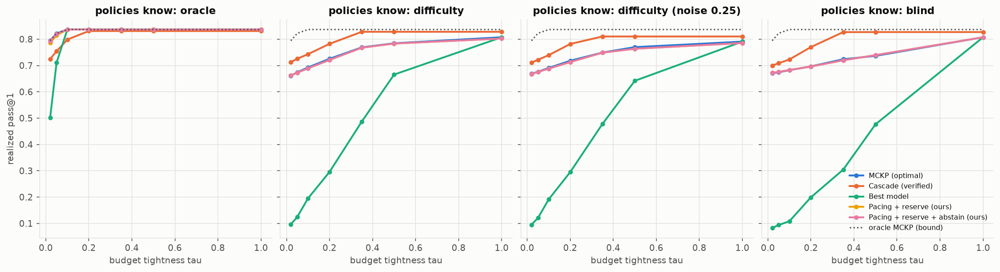

# E7 - Information regimes and noisy difficulty labels

**Question.** How do conclusions change with what agents and controllers know about q_{i,m}? Is coordination
or information the bigger lever?

**Setup.** Uniform mix, N = 20 × 10, 7 budgets, 20 instances × 5 permutations. Conditions: **oracle**
(per-task realized outcome), **difficulty** (calibrated class pass rates) with labels flipped at random with
probability ε ∈ {0, 0.1, 0.25, 0.5}, and **blind** (overall pass rates only). All policies are scored on
**realized pass@1**. The oracle MCKP of the same task sample is the absolute upper bound. Script: `e07_information.py`.
Notebook: `notebooks/04_information_and_learning.ipynb`.

## Results

Realized pass@1 at τ = 0.2 (oracle MCKP bound = 0.837):

| policy | oracle | difficulty | difficulty ε=0.25 | difficulty ε=0.5 | blind |
|---|---|---|---|---|---|
| MCKP (optimal) | 0.837 | 0.726 | 0.718 | 0.709 | 0.697 |
| Cascade (verified) | 0.831 | **0.782** | 0.782 | 0.783 | 0.770 |
| Best model | 0.837 | 0.296 | 0.295 | 0.297 | 0.199 |
| Best model + reserve | 0.837 | 0.715 | 0.710 | 0.706 | 0.703 |
| Pacing + reserve (ours) | 0.837 | 0.721 | 0.713 | 0.705 | 0.696 |

Worst gap to *its own regime's* MCKP over all budgets (%):

| policy | oracle | difficulty | ε=0.1 | ε=0.25 | ε=0.5 | blind |
|---|---|---|---|---|---|---|
| Best model | 36.9 | 85.7 | 85.7 | 85.7 | 85.8 | 87.5 |
| Best model + reserve | 1.3 | 6.0 | 6.1 | 6.0 | 5.7 | 0.6 |
| Pacing + reserve (ours) | 1.0 | 0.24 | 0.24 | 0.24 | 0.23 | 0.05 |
| Pacing + reserve + abstain (ours) | **0.29** | 0.24 | 0.24 | 0.24 | 0.23 | 0.05 |

(The two pacing lines coincide except in the oracle regime.)

## Takeaways

1. **The mechanism is information-agnostic.** In every regime, including per-task heterogeneous oracle values
   and noisy labels, pacing + reserve stays within 1% of that regime's optimum.
2. **Information beats coordination here.** At τ = 0.2, knowing per-task outcomes is worth 11 points of
   pass@1 (0.837 vs 0.726), while coordination at fixed (difficulty) information is worth at most 0.5 points
   over the mechanism. Even uncoordinated greedy agents with oracle knowledge reach the bound once τ ≥ 0.1.
3. **Verification is a cheap source of information.** The FrugalGPT-style cascade with unit-test verification
   recovers about half of the information gap (0.782). At τ = 0.2 its realized quality is unaffected by label
   noise; at τ = 0.5 it drops 3.6 points at ε = 0.5 (0.828 → 0.792), about as much as MCKP.
4. Label noise degrades everyone roughly equally: MCKP drops 1.7 points at ε = 0.5 and the mechanism tracks it.
   The relative conclusions are unchanged.
