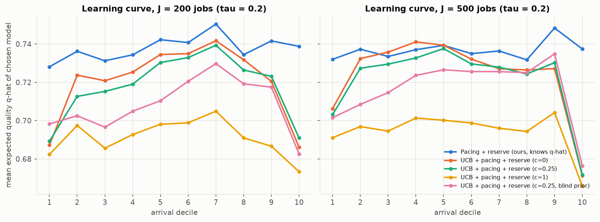

# E8 - Learning agents (online UCB extension, D6)

**Question.** If q_{i,m} is *unknown*, can agents learn it online and still allocate the shared budget well?
How much does that cost (regret)?

**Setup.** New framework utility `ucb_pacing`. Agents keep shared per-(difficulty label, model) pass-rate
estimates, updated from the revealed outcome of every earlier call (unit tests pass/fail). Each agent scores
models by UCB = Beta-posterior mean + c·√(ln N_d / (n+1)) minus the pacing price. The price starts from the
floor price only, with no historical λ\*. The engine reserve is on. Variants: c ∈ {0, 0.25, 0.5, 1}, and a
warm start from the overall (blind) pass rates as a 5-pseudo-observation prior. Reference: the same pacing
+ reserve agents told q̂ (with and without a price history). J ∈ {200, 500}, τ ∈ {0.05, 0.2, 0.5},
20 instances × 5 permutations. Regret = expected successes lost vs. the informed agents. Script: `e08_learning.py`.

## Results

| J | τ | informed pacing gap | best learner (c) | learner gap | regret (successes) | regret per job |
|---|---|---|---|---|---|---|
| 200 | 0.05 | 0.0% | c = 0 | 1.9% | 2.6 | 1.3% |
| 200 | 0.2 | 0.07% | c = 0 | 2.4% | 3.4 | 1.7% |
| 200 | 0.5 | 0.2% | c = 0.25 | 5.0% | 7.5 | 3.7% |
| 500 | 0.05 | 0.0% | c = 0 | 1.7% | 5.8 | 1.2% |
| 500 | 0.2 | 0.02% | c = 0 | 1.8% | 6.4 | 1.3% |
| 500 | 0.5 | 0.2% | c = 0.25 | 2.7% | 9.6 | 1.9% |

* Informed pacing **with no price history** matches the λ\*_hist version in every cell.
* Realized pass@1 of the best learner vs. the informed agents: 0.731 vs 0.721 (J = 200, τ = 0.2) and
  0.758 vs 0.783 (τ = 0.5).
* A strong exploration bonus hurts (c = 1: 6.4% gap at τ = 0.2). A blind-pass-rate prior did not help.

## Takeaways

1. **Learning works and amortizes.** Starting from zero knowledge, learners lose 1.7–5% of expected welfare,
   and per-job regret falls as the horizon grows (e.g. 3.7% → 1.9% at τ = 0.5). The learning curve shows the
   cost is paid in the first decile.
2. The optimistic Beta(1,1) prior already explores enough. Little or no UCB bonus is best, because exploring
   R1 is expensive under a shared budget.
3. On *realized* pass@1, learners match or beat agents given calibrated q̂ at tight budgets. They learn from the
   current batch's actual outcomes rather than from a historical calibration set.
4. Learners dip in the last decile: they underspend while uncertain, then the floor and the remaining budget
   squeeze the end of the horizon.
5. Together with E6-B: the plain pacing + reserve mechanism needs **only public ledger state** (B, B_k, k, J)
   and the price range, with no prior price and no prior quality knowledge.
