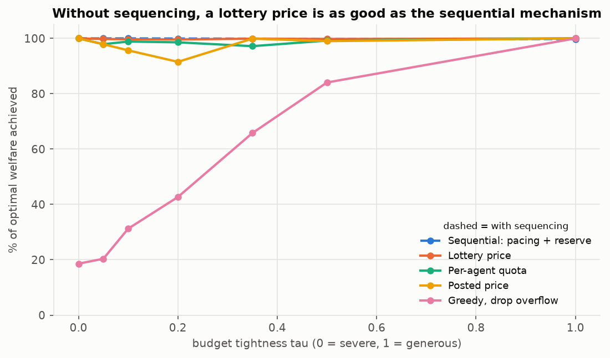
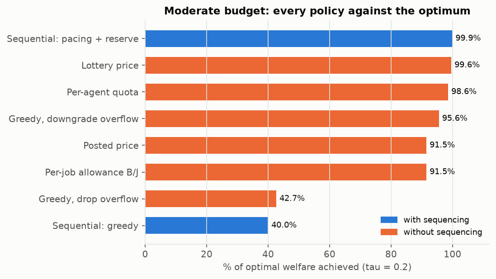
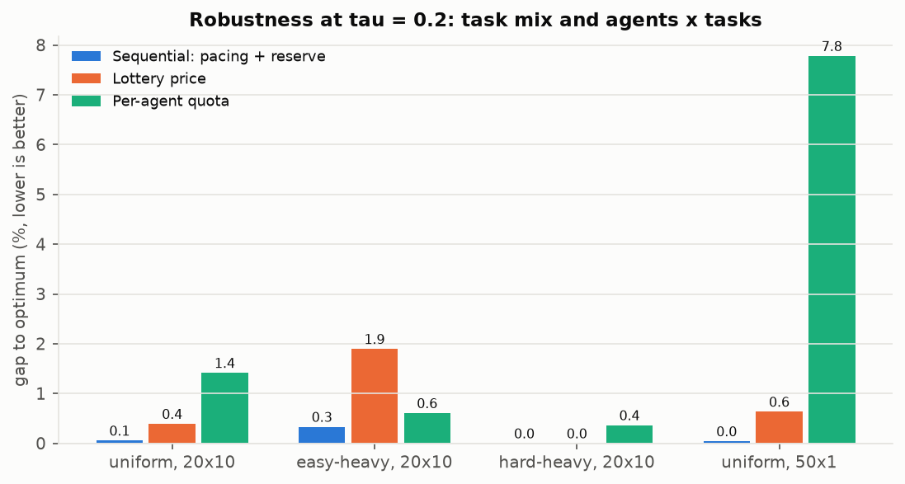

# E9 - Without the sequencing layer

**Question.** The decentralized game is sequential: jobs arrive one at a time and each agent sees the budget
B_k its predecessors left. How well can agents do if that layer is removed, so that every job picks its model
at the same time and knows only B, J and the model costs?

**Setup.** New engine `simultaneous_best_response`: all jobs decide at once, with B_k = B, step 0 and no
history (so a pacing price reduces to its reference price). The ledger then settles the requests in a random
order the agents never see. Either it **drops** a request that no longer fits (the job starves), or it
**downgrades** it so that every unsettled request keeps c_min (the budget reserve). Difficulty regime, measured
costs, uniform mix, N = 20 × 10, τ ∈ {0, 0.05, 0.1, 0.2, 0.35, 0.5, 1}, 20 instances × 10 settlement orders.
Robustness at τ = 0.2: easy-heavy and hard-heavy mixes, and 50 agents × 1 task. Script: `e09_no_sequencing.py`.

Policies without sequencing:

| policy | rule |
|---|---|
| Greedy, drop overflow | best model; requests that no longer fit are dropped |
| Greedy, downgrade overflow | best model; the ledger downgrades requests to keep c_min per job |
| Per-job allowance B/J | best model costing at most B/J; can never overspend |
| Per-agent quota | each agent spends B·n_i/J on its own tasks (exact local knapsack) |
| Posted price | q − λ\*_hist·c (price from the calibration split), downgrade settlement |
| Lottery price (new) | λ\*_hist, but each job draws a price just below it with probability θ (calibrated on history so the expected spend equals B), downgrade settlement |

## Results

% of the optimal welfare achieved (= 100 − gap to MCKP), uniform mix, N = 20 × 10:

| policy | τ = 0 | 0.05 | 0.1 | 0.2 | 0.35 | 0.5 | 1 |
|---|---|---|---|---|---|---|---|
| *With sequencing:* greedy | 13.9 | 18.3 | 27.5 | 40.0 | 61.7 | 83.3 | 100 |
| *With sequencing:* pacing + reserve | 100 | 100 | 99.99 | 99.94 | 99.91 | 99.78 | 99.76 |
| Greedy, drop overflow | 18.6 | 20.4 | 31.2 | 42.7 | 65.8 | 84.1 | 100 |
| Greedy, downgrade overflow | 100 | 98.0 | 97.1 | 95.6 | 94.0 | 96.9 | 100 |
| Per-job allowance B/J | 100 | 97.9 | 95.7 | 91.5 | 86.4 | 85.6 | 100 |
| Per-agent quota | 100 | 97.9 | 98.9 | 98.6 | 97.2 | 99.2 | 100 |
| Posted price | 100 | 97.9 | 95.7 | 91.5 | 99.9 | 99.0 | 100 |
| **Lottery price** | 100 | **99.8** | **99.7** | **99.6** | **99.9** | **99.8** | 100 |

Gap to MCKP (%) at τ = 0.2 in other settings:

| policy | uniform 20×10 | easy-heavy | hard-heavy | uniform 50×1 |
|---|---|---|---|---|
| Sequential pacing + reserve | 0.06 | 0.33 | 0.00 | 0.04 |
| Lottery price | 0.39 | 1.90 | 0.00 | 0.64 |
| Per-agent quota | 1.42 | 0.61 | 0.36 | 7.78 |
| Greedy, downgrade overflow | 4.40 | 0.00 | 1.96 | 3.83 |

## Takeaways

1. **The sequencing layer is not where the value comes from.** A lottery price, with no order and no B_k
   feedback, reaches at least 99.6% of the optimum at every budget. That is within 0.4 points of the sequential
   pacing mechanism.
2. **What matters is the settlement rule.** Greedy agents lose 57% when overflowing requests are dropped,
   the same as in the sequential game (60%). If the ledger downgrades overflowing requests instead, they lose
   only 4.4%. Starvation, not ordering, is the failure.
3. **A single posted price is not enough without feedback.** At λ\*_hist the marginal class is indifferent,
   so all of it stays on the cheap model (budget use 19%, 8.5% gap). In the sequential game the pacing feedback
   fixes this. Without sequencing, a coin flip with the right probability θ does the same job.
4. **Splitting the budget works when agents have many tasks.** A per-agent quota is within 1.4% with 10 tasks
   per agent, but drops to 7.8% with one task each (then it is the same as a per-job allowance).
5. **The cost of no feedback is robustness to shifts in the mix.** θ is calibrated on the uniform history.
   On an easy-heavy batch the lottery loses 1.9%, the sequential mechanism 0.3%, because the pace feedback
   adapts to the actual batch and a fixed θ cannot.

**Bottom line.** Without the sequencing layer we can still get within 0.4% of the optimum at moderate budgets,
provided that (a) the ledger downgrades instead of dropping requests and (b) agents use a calibrated
lottery price. The sequencing layer (via pace feedback) mainly buys robustness when the task mix differs
from history.
