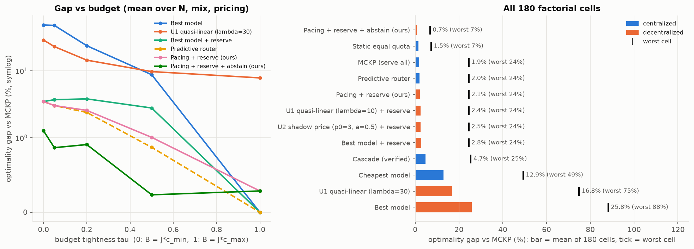

# Final results: multi-agent model selection under a shared budget

Study of the project proposal ([project_proposal/](project_proposal/)) on real LiveCodeBench outcomes from
LLMRouterBench: 1,055 coding tasks, 4 models from $0.0011 to $0.0289 per call, binary pass@1. Eight
experiments, about 335k simulated allocation runs. Per-experiment notes: [experiments/](experiments/README.md).
Notebooks: [notebooks/01–04](notebooks/).

## Summary

1. **The tragedy of the commons is severe.** Agents that each buy their best affordable model lose **60%** of the
   optimal welfare at a moderate budget and **86%** at a severe one. 62% of tasks starve, including easy tasks any
   model would solve. Welfare depends heavily on arrival luck. Across 180 factorial cells the mean price of anarchy is 25.8%.
2. **Most of the loss is starvation, and a one-line ledger rule removes it.** The *budget reserve* forbids any
   call that would leave less than c_min per waiting job. It cuts the gap from 60% to 4.4%, and from 25.8% to
   2.8% across the factorial.
3. **A pace-aware shadow price closes the rest without a coordinator.** Each agent maximizes
   q − p_k·c, where p_k rises when the shared budget is spent faster than jobs are served:
   - With the reserve: **0.06% gap at moderate budget, worst 0.36% over all mixes and budgets**, and
     **0.23% from the best serve-everyone allocation over all 180 cells**. That is level with a centralized
     predictive router (0.11%) and far better than every utility in the proposal (U1–U4).
   - It needs only public ledger state, no tuning per budget, and no prior price.
   - It stays within 1% of the optimum under oracle, coarse and noisy information. Agents that must learn the
     model qualities online lose only 1.7–5%.
4. **The remaining gap to the true optimum is a fairness choice, not a coordination failure.** When premium calls
   are cheap, the optimum *refuses* service to low-value tasks. Letting priced agents abstain voluntarily brings
   the mean gap to **0.71%**. That is the best non-oracle policy in the study, including the centralized ones,
   at the cost of 5% of tasks going unserved.



## Setup

* **Agents and tasks.** N agents × tasks per agent, drawn from the evaluation split (738 tasks). Every task is one
  model call paid from the shared budget B. Defaults: N = 20 × 10 tasks, uniform difficulty mix, measured costs.
* **Budget.** B = J·c_min + τ·J·(c_max − c_min). τ = 0 is the proposal's "severe" level, τ = 1 its
  "generous" level, and τ = 0.2 is "moderate".
* **Information.** The dataset's quality is the *realized* pass/fail, so knowing it means knowing the answer in
  advance. Policies therefore see the **calibrated expected quality** q̂ by default: the pass rate of each model on
  calibration-split tasks with the same difficulty label. They are also scored on realized pass@1. E7 varies this
  (oracle / noisy labels / blind).
* **Paradigms.** Centralized: exact MCKP (OR-Tools; the optimum and the reference), predictive router,
  FrugalGPT cascade (escalates on real unit-test outcomes), static equal quota, cheapest model. Decentralized:
  the sequential best-response game with 5 arrival policies and the proposal's utilities: best model (B2), U1
  quasi-linear, U2 dynamic shadow price, U3 Shapley share, U4 marginal ROI, plus the mechanism below.
* **Protocol.** Parameters are tuned and the final mechanism is selected on the calibration split. Reported numbers come
  from the evaluation split, as means over 10–20 task samples × 5–10 random arrival orders. The gap is
  (SW_MCKP − SW)/SW_MCKP on expected quality, paired per sample.

## The mechanism: pacing price + budget reserve

```
U_i(m) = q_{i,m} − p_k · c_m,     p_k = max(λ*_hist, p_min) · exp(β · (s_k − k/J))
feasible: c_m ≤ B_k − (J − k − 1) · c_min        (budget reserve, enforced by the ledger)
```

* s_k = (B − B_k)/B is the share of the budget already spent, and k/J the share of jobs already served.
* λ\*_hist is the Lagrangian price of the MCKP relaxation on historical tasks at the same budget per job
  (`calibrate_price`). It is optional (E6-B, E8).
* p_min = 0.1/(c_max − c_min), β = 10.
* Implemented as the `budget_pacing` utility plus `decentralized.params: {reserve: true}` (optionally
  `abstain: true`). Reproduce with `python -m masbudget configs/final_mechanism.yaml`.

Why it works: on this data the optimal price is a step function (E1). At the optimum the marginal task class is
*indifferent* between the cheap and the premium model, so any static price, even the exact λ\*, buys the premium
model for all of the class or none of it (8.5–47% loss, E4/E5). The pace feedback makes the price oscillate
around λ\*, which buys exactly the right fraction. This is the dual-descent idea of budget pacing (Balseiro & Gur
2019). The reserve guards against what feedback cannot fix in time: early overspending and a misjudged horizon.

## Answers to the research questions

**RQ1 – Size of the efficiency gap (E2, E6).** Price of anarchy of naive agents:

| budget τ | 0 (severe) | 0.05 | 0.2 (moderate) | 0.5 | 1 (generous) |
|---|---|---|---|---|---|
| Best model, difficulty regime (E2) | 86.1% | 81.7% | 60.0% | 16.7% | 0% |
| Best model, oracle regime (E2) | 55.9% | 13.2% | 0% | 0% | 0% |
| Pacing + reserve (E4, eval split) | 0% | 0% | 0.06% | 0.10% | 0% |

The repo's default utility parameters (λ = 0.5, p0 = 0.1) give exactly the best-model outcome: with costs around
10⁻³ USD, the cost term is negligible. Utilities must be scaled in quality per dollar (λ\* ≈ 11.6).

**RQ2 – Arrival order and position privilege (E3).** Under random arrival, greedy agents in the first 30% of the
queue get q̂ ≈ 0.8 and those after 50% get nothing (first-mover ratio ∞, 62% of tasks starved). Welfare SD across
permutations is 2.76 tasks. With pacing + reserve the quality profile is flat (first-mover ratio 1.00,
SD 0.14), and with one task per agent Jain's index equals the optimum's (0.84 vs 0.41 for greedy).

**RQ3 – Queue scheduling policies (E3).** Re-ordering alone does not fix it: with greedy agents, hardest-first is
the *worst* order (86% gap) and marginal-ROI priority 67%. **Hardest-first + reserve is near-optimal (1.1%)**,
so the proposal's HTF hypothesis holds once starvation is ruled out. Pacing prefers uncoordinated arrival
(0.1%) to sorted queues (1.5–5.6%). Use a coordinator's sorted queue *or* a pacing price, not both.

**RQ4 – Utility engineering (E4, E5).** Each proposed utility, tuned at τ = 0.2 on the calibration split and
evaluated at all 9 budgets (worst-case gap):

| utility | no reserve | + reserve |
|---|---|---|
| U1 quasi-linear (λ tuned) | 15.3% | 2.0% |
| U2 dynamic shadow price p0(B/B_k)^α (tuned) | 76.2% | 2.0% |
| U3 Shapley budget share (tuned) | 69.6% | 2.5% |
| U4 marginal ROI ratio | 83.1% | 2.0% |
| **Pacing price (ours)** | **1.2%** | **0.5%** (0.36% with the final floor) |

Fixed prices are right only inside a window set by the task ROIs (λ ∈ [2, 11] here), and the window moves with
pricing and task mix. Under a hard-heavy shift, a fixed λ tuned on uniform history loses 49% and a posted price
calibrated on the batch itself loses 47%; pacing + reserve loses 0.4%. U3's original characteristic function gives
larger Shapley values to agents with *easier* tasks (it is additive in their quality), the opposite of the
intent. An `upgrade_gain` variant fixes the direction but adds nothing over a correct price.

**RQ5 – Task mix, budget, agent count, cost disparity (E6, 180 cells).**
* Greedy agents fail catastrophically (38–77% gap) whenever τ ≤ 0.2 under steep or measured pricing, and the
  failure *grows with N* (18.7% → 30.5% from 5 to 50 agents). They are near-optimal only with a generous budget,
  or with easy-heavy batches at τ ≥ 0.2.
* Pacing + reserve averages 2.1%; its gap *shrinks* with N (2.2% → 2.0%). Measured against the serve-everyone
  optimum it is 0.23% (worst 3.1%).
* Flat pricing (premium = 2× cheapest) is the one hard case for *every* policy that serves all agents, the
  centralized router and quota included (24.5% worst cell). There the optimum deliberately leaves low-value hard
  tasks unserved to fund premium calls elsewhere. Abstention under the price recovers this (flat-pricing gap
  5.8% → 1.3%).

**Proposal sub-questions.** (1) Reducing the budget hurts uncoordinated agents sharply: from 0% to 86% gap as τ goes from
1 to 0. Coordinated or priced agents lose only what the optimum loses. (2) More agents make naive allocation
worse and paced allocation slightly better. (4) Expensive models are worth it on hard tasks (+0.32 pass@1 for
$0.028, 11.6/$), barely on medium ones (1.7/$), and not on easy ones. (5) A steeper premium makes greedy agents
worse, while a flatter premium makes service refusal (abstention) valuable.

## Further findings

* **Information is worth more than coordination (E7).** At τ = 0.2, per-task knowledge lifts realized pass@1
  from 0.726 (centralized optimum with difficulty-level knowledge) to 0.837. Coordination given fixed information
  adds at most 0.5 points over the mechanism. A cascade with unit-test verification recovers half of the
  information gap (0.782) and is the best policy on *realized* pass@1 at tight budgets.
* **Learning agents (E8, proposal D6).** With qualities unknown and learned online from call outcomes (shared UCB
  estimates + pacing price, no price history), agents lose 1.7–5% of expected welfare. Per-job regret falls with
  the horizon (3.7% → 1.9% from J = 200 to 500 at τ = 0.5). A small or zero exploration bonus is best.
* **The sequencing layer is not essential (E9).** If all agents decide at once, with no arrival order and no
  view of the remaining budget, a *lottery price* (λ\*_hist, with a calibrated share θ of jobs pricing just
  below it) plus a ledger that downgrades overflowing requests reaches at least 99.6% of the optimum at every budget
  (sequential pacing + reserve: 99.8–100%). Greedy agents lose 57% if overflow is dropped but only 4.4% if it is
  downgraded. Sequencing mainly buys robustness to a task mix that differs from history (easy-heavy: 1.9% vs 0.3%).
* **Robustness (E5).** Under-estimating the horizon by 2× costs ≤ 3% with the reserve (41% without). A
  reference price off by 100× costs ≤ 5% with the reserve.

## Caveats

* **One benchmark, coarse information.** Difficulty labels are derived from these models' outcomes (see
  `docs/llmrouterbench_data_provenance.md`), and q̂ has only three classes. That makes the problem
  class-structured, which favours every reserve-based rule. The oracle and noisy-label regimes (E7) and the
  factorial (E6) are the checks against over-reading this.
* **Costs are mean per-call costs** (fixed per model). Real per-call costs vary (R1: $0.001–0.07).
* **Known horizon.** The mechanism uses the number of jobs J in the budget period. E5-C quantifies the sensitivity.
* **Abstention trades fairness for welfare.** It leaves 5% of tasks unserved. Which objective is right is a
  deployment decision.
* **Expected vs realized metrics.** Gaps are reported on expected quality, as the proposal defines social
  welfare. Realized pass@1 agrees within noise (95% CI ≈ ±1–2 points per policy), except for the
  verified cascade, which uses extra information.

## Reproducibility

Everything runs offline from the committed data: see [experiments/README.md](experiments/README.md) (scripts,
about 35 minutes on 12 cores). Summary CSVs are in `experiments/results/`, figures in `experiments/figures/`.
Framework changes are listed there too and covered by `tests/test_study_extensions.py` (273 tests pass).
