# Decentralized vs. Centralized Model Selection Under a Shared Budget - Results

**Question (proposal §3):** when *N* autonomous agents share one API budget *B* and each picks an LLM for its own task, how far is decentralized sequential best-response from the centralized optimum, and which ordering / utility designs close the gap?

**Bottom line (final).** From these experiments we derived a new decentralized utility, **Fair-Share Shadow Pricing (FSSP)** ([§3](#3-proposed-algorithm-fair-share-shadow-pricing-fssp)). Each agent prices money by the inverse of the budget still available per request still to come, `p_k = κ · R̂_k / B_k`, and picks `argmax_m q̂_m − p_k·c_m`. With **one** setting (κ = 0.1) for every budget, mix, model pool and agent count, FSSP under plain random arrival reaches mean pass@1 **0.691, the same as the exact centralized optimum (MCKP, 0.691)**: gap −0.1 % [95 % CI −0.4, 0.1], no starved task, Jain 0.96. Every baseline utility needs its price re-tuned for each budget to get close. FSSP needs no scheduler, and it does not need to know the total number of requests: an online estimate of the remaining demand gives a 0.1 % gap. This is the method we recommend.

**Findings from the design-space study (§2, §4).** Naive decentralized selection (each agent buys its best affordable model) loses **54–90 %** of the achievable quality at tight budgets, which confirms a large price of anarchy (PoA). That loss is **not inherent to decentralization**. When agents use a *scarcity-aware* utility whose cost sensitivity is calibrated to the per-task budget, the best decentralized configuration comes within **0–3 %** of the exact centralized optimum (MCKP) at every mix and budget in the realistic information setting. The dynamic shadow price is the most robust utility: ≤ 2.1 % mean gap per mix and budget regime, 0.4 % overall, and 10.4 % in its single worst cell. The proposal's guesses about *which* mechanisms help were partly wrong. **Easiest-task-first is the best ordering, not the worst.** Hardest-first and marginal-ROI priority are *worse* than random arrival. Centralization keeps a real advantage only when (i) the planner sees per-task outcomes the agents can't estimate (up to 14 % gap with oracle information on hard-heavy work at tight budgets), or (ii) nobody calibrates the agents' cost sensitivity. FSSP (§3) removes (ii).

---

## 1. Experimental setup

| Item | Value |
|---|---|
| Data | LLMRouterBench `livecodebench/test`, 1,055 tasks × 6 models, real binary pass@1 and measured mean $/call (`data/llmrouterbench_livecodebench*.json`) |
| Models (cost per call, overall pass@1) | deepseek-v3.1-terminus $0.00112 (67.3 %) · deepseek-v3-0324 $0.00145 (66.6 %) · gemini-2.5-flash $0.00583 (60.0 %) · claude-sonnet-4 $0.01346 (58.1 %) · deepseek-r1-0528 $0.02887 (80.1 %) · gemini-2.5-pro $0.13515 (79.2 %) |
| Agents / tasks | N = 10 agents × 10 tasks each (100 model calls) unless stated; N ∈ {5, 10, 20, 50} for H2 |
| Difficulty mixes | uniform (⅓ easy / ⅓ medium / ⅓ hard), easy-heavy (80/10/10), hard-heavy (10/10/80), sampled per seed from the 1,055-task pool |
| Budget | B = k · c_min · (#tasks), with k ∈ {1, 1.5, 3, 6, 12, 25, 50, 120}. k = 1 is *severe* (everyone can afford only the cheapest model) and k = 120 = c_max/c_min is *generous* (everyone can afford gemini-2.5-pro) |
| Seeds | 50 test seeds (0–49) per cell; hyper-parameters tuned on 20 separate tuning seeds (1000–1019) |
| Centralized (5) | Optimal MCKP (exact ILP, OR-Tools SCIP), Predictive router, Confidence cascade, Static equal quota, Cheapest model |
| Decentralized (25) | 5 arrival orders {round-robin FCFS, random, hardest-first (HTF), easiest-first (ETF), marginal-ROI priority} × 5 utilities {best-model, quasi-linear, dynamic shadow price, Shapley budget share, ΔU/ΔC ratio}, using the repo's `SequentialBestResponse` game |
| Metrics | realized mean pass@1 *Q*, optimality gap = (Q_MCKP − Q)/Q_MCKP paired on the same instance, task and agent starvation, Jain's index on agent payoffs, first-mover advantage, budget utilization |
| Runs | 351,900 policy runs in total. Design-space study: 223,740 (tune 27,840 · main 72,000 · scale 36,000 · disparity 72,000 · label-noise 13,500 · agent-burst 2,400). FSSP study: 128,160 (tune 9,760 · test 76,800 · scale 19,200 · label-noise 7,200 · agent-burst 2,000 · unknown-n 13,200) |

### 1.1 Two information settings

The original pipeline let every policy read the *realized* pass/fail of every (task, model) pair, so even "decentralized" agents knew the outcome before choosing. We now report two settings, and both score against the realized pass/fail:

* **Expected (primary, realistic).** A policy sees q̂(i, m), the pass rate of model *m* on task *i*'s difficulty tier. It is estimated by 5-fold cross-fitting, so a task's own outcome never enters its estimate.
* **Oracle (upper bound).** A policy sees the true per-task pass/fail, as before.

MCKP is optimal for *what it sees*. In the expected setting it maximizes Σq̂, so its realized score can be beaten by luck, and small negative gaps appear. Table 2 therefore also reports the gap on the q̂ objective, where MCKP is exactly optimal.

### 1.2 Utility calibration

Model costs are $0.001–$0.135, so the proposal defaults (λ = 0.5, p₀ = 0.1) put a cost penalty of at most 0.07 against qualities in [0, 1]. With those defaults, **quasi-linear, shadow-price and Shapley utilities all behave exactly like greedy best-model.** We therefore tuned λ (quasi-linear, Shapley) and (p₀, α) (shadow price) on tuning seeds, separately for each budget level. That is legitimate because each agent observes *B* and *N*. Fig. 8 and Table 8 show how much the result depends on this.

> † The confidence cascade decides whether to escalate by running the unit tests after each paid call. It therefore uses realized outcomes in both settings: an information advantage, not a coordination advantage.

---

## 2. Headline: centralized vs. decentralized

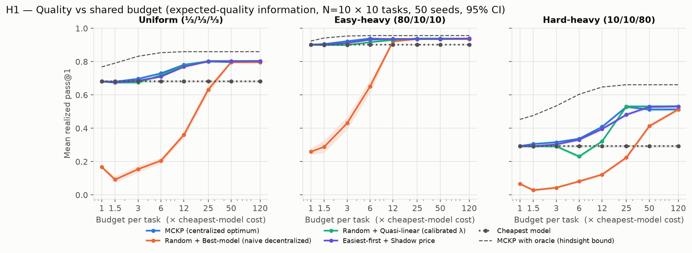

**Fig. 1.** Realized pass@1 vs. per-task budget (expected information, 95 % bootstrap CI over 50 seeds). The calibrated decentralized configurations (green, purple) sit on top of the MCKP optimum (blue). The naive decentralized policy (orange) collapses below even the cheapest-model baseline until the budget reaches about 25–50× c_min. The dashed line is MCKP with oracle information.

**Table 1 - Overall league (expected information, mean over 3 mixes × 8 budgets × 50 seeds).** Selected rows; the full 30-row table is in `results/hypotheses/report_tables.md`.

| Paradigm | Policy | Mean Q | Gap % | Task starve % | Agent starve % | Jain | Budget used % |
|:---|:---|:---:|:---:|:---:|:---:|:---:|:---:|
| Centralized | Cascade† (sees test results) | **0.728** | −7.3 | 0.0 | 0.0 | 0.952 | 83.4 |
| Centralized | **MCKP (optimal)** | 0.691 | 0.0 | 0.0 | 0.0 | 0.943 | 83.7 |
| Centralized | Predictive router | 0.691 | −0.1 | 0.0 | 0.0 | 0.944 | 82.5 |
| Decentralized | **Marginal-ROI priority + Shadow price** | **0.691** | **−0.1** | 0.0 | 0.0 | 0.944 | 69.9 |
| Decentralized | Random + Shadow price | 0.689 | 0.4 | 0.0 | 0.0 | 0.944 | 68.8 |
| Centralized | Equal quota (B/N each) | 0.688 | 0.5 | 0.0 | 0.0 | 0.941 | 67.9 |
| Decentralized | Easiest-first + Shadow price | 0.687 | 0.9 | 0.0 | 0.0 | 0.943 | 65.6 |
| Decentralized | Random + Quasi-linear | 0.680 | 2.7 | 3.4 | 8.5 | 0.938 | 57.5 |
| Centralized | Cheapest model | 0.626 | 11.1 | 0.0 | 0.0 | 0.919 | 29.0 |
| Decentralized | Random + ΔU/ΔC ratio | 0.515 | 28.1 | 19.9 | 37.0 | 0.872 | 56.9 |
| Decentralized | Random + Best-model (naive) | 0.419 | 45.3 | 45.5 | 69.1 | 0.767 | 84.4 |
| Decentralized | Hardest-first + Best-model | 0.293 | 62.0 | 55.6 | 72.2 | 0.608 | 84.5 |

**Table 2 - Gap by mix and budget (expected information).** "Best decentralized" is the best of the 25 configurations in that cell.

| Mix | Budget ×c_min | MCKP Q | Naive Q | Naive gap % | Random+QL gap % | Best decentralized | Best dec. gap % [95 % CI] | Best dec. gap on q̂ objective % |
|:---|:---:|:---:|:---:|:---:|:---:|:---|:---:|:---:|
| uniform | 1 | 0.681 | 0.168 | 75.4 | 0.0 | ETF + Shadow price | 0.0 [0.0, 0.0] | 0.0 |
| uniform | 3 | 0.697 | 0.155 | 77.8 | 3.2 | HTF + Shadow price | 0.0 [−0.8, 0.8] | 0.5 |
| uniform | 6 | 0.730 | 0.206 | 71.7 | 1.6 | ROI-priority + Shadow price | −0.3 [−1.3, 0.5] | 0.5 |
| uniform | 12 | 0.781 | 0.361 | 53.8 | 0.8 | Random + Shadow price | 0.1 [−0.3, 0.6] | 0.7 |
| uniform | 25 | 0.802 | 0.632 | 21.2 | −0.3 | ETF + Shapley | −0.3 [−0.8, 0.2] | 0.1 |
| uniform | 120 | 0.797 | 0.797 | 0.0 | −0.9 | ETF + Shadow price | −0.9 [−1.5, −0.2] | 0.0 |
| easy-heavy | 3 | 0.923 | 0.431 | 53.4 | 2.5 | ROI-priority + Shadow price | 0.1 [−0.2, 0.4] | 0.3 |
| easy-heavy | 6 | 0.939 | 0.651 | 30.6 | 2.4 | ETF + Shadow price | 0.8 [0.4, 1.1] | 0.8 |
| easy-heavy | 12 | 0.935 | 0.921 | 1.5 | 0.6 | ETF + Shadow price | −0.1 [−0.5, 0.3] | 0.0 |
| hard-heavy | 1.5 | 0.306 | 0.029 | 90.4 | 4.3 | ROI-priority + ΔU/ΔC | 0.2 [−0.5, 0.8] | 0.4 |
| hard-heavy | 6 | 0.337 | 0.082 | 75.6 | 31.4 | ROI-priority + Shadow price | −2.2 [−4.5, 0.2] | 2.9 |
| hard-heavy | 12 | 0.409 | 0.122 | 70.0 | 21.0 | ROI-priority + Shadow price | −5.2 [−7.8, −2.5] | 1.3 |
| hard-heavy | 50 | 0.512 | 0.413 | 19.3 | −3.8 | ETF + Quasi-linear | −3.8 [−5.1, −2.5] | 0.8 |

All 24 rows: `results/hypotheses/summary_central_vs_decentral.csv`. Negative realized gaps occur because MCKP is only optimal for the *estimated* q̂. On the hard tier, r1 and gemini-pro differ by 0.9 pp in q̂, and MCKP sometimes pays 4.7× more for pro, which does not pay off on these tasks. On the objective MCKP actually optimizes, the best decentralized configuration is never more than **2.9 %** behind.

---

## 3. Proposed algorithm: Fair-Share Shadow Pricing (FSSP)

The design-space study (§2, §4) showed three things a good decentralized utility must do:

1. **It must price money at all.** Greedy agents buy gemini-2.5-pro ($0.135) for tasks that a $0.001 model solves.
2. **The price must match the budget scale.** The best fixed λ is ≈ 0.07 / (B/n), and tuned prices span about three orders of magnitude across budgets. One λ or p₀ for all budgets collapses to "always buy the cheapest model" (Table 8).
3. **The price should react to how the budget is being spent, not just how much is left.** The shadow price p₀(B/B_k)^α always rises along the queue, even when everyone spent exactly their share, so late agents are taxed for being late (this is the 8–12 pp first-mover premium in Table 9).

FSSP fixes all three by measuring cost in units of the **fair share still available per request still to come**.

### 3.1 The rule

Notation: requests are numbered by arrival, k = 0, 1, 2, …, so when request k arrives, k requests have already been served and paid for. B is the total budget, B_k the remaining budget, c_m the price of model m, and q̂_{i,m} the agent's own estimate that model m solves its task i. R_k is the number of requests still to be served, this one included (R_k = n − k if the total n is known).

```
f_k = B_k / R̂_k                 remaining fair share per request
p_k = κ / f_k = κ · R̂_k / B_k    price of one dollar, in pass@1 units
U_k(m) = q̂_{i,m} − p_k · c_m     the agent picks argmax over affordable models (c_m ≤ B_k)
```

κ = 0.1 means "an upgrade must raise the pass probability by at least 0.1 for every extra fair share it costs". (The general form in the paper is p_k = (κ/b)(b/f_k)^α with b = B/n. The selected α = 1 makes b cancel, so n is never needed by itself.)

### 3.2 Full algorithm, including the realistic case where n is unknown

In a live system nobody knows in advance how many requests will arrive. FSSP needs only R̂_k, an estimate of how many are still to come, and each agent can compute that from public information. The budget B is assumed to cover a **period** (e.g. one billing month), and t ∈ (0, 1] is the fraction of that period that has elapsed.

When a request of agent *a* (task i) arrives at time t:

1. **Read the ledger:** the remaining budget B_k and the number of requests that arrived before this one, k. The ledger is a passive counter, like a prepaid account balance. It never decides anything.
2. **Estimate the remaining demand.**
   * If the total n is known (a fixed batch): R̂_k = n − k.
   * Otherwise (online): the arrival rate so far is r̂ = (k + 1 + w·n₀) / (t + w) requests per period, and the requests still to come are R̂_k = 1 + r̂·(1 − t), this one plus the expected future ones. Here n₀ is an optional prior guess of the period's demand and w its weight (in period units). With no guess, w = 0, so r̂ = (k + 1)/t.
3. **Compute the price:** f_k = B_k / R̂_k and p_k = κ / f_k.
4. **Choose:** among the models with c_m ≤ B_k, pick m* = argmax q̂_{i,m} − p_k·c_m. If none is affordable, the request is starved.
5. **Pay:** B_{k+1} = B_k − c_{m*}, and the ledger counter becomes k + 1.

Why this works online: if more requests arrive than expected, r̂ and R̂_k rise, f_k falls and the price rises automatically. If fewer arrive, the price falls and later agents may upgrade. Early in the period, when the rate estimate is noisy, the prior n₀ (if any) steadies it. Without a prior the first few requests see a noisy estimate, but their spending is small relative to B. Nothing is coordinated. Each agent runs this independently, in O(|models|) time.

Implementation: [scripts/hypotheses/fair_share.py](scripts/hypotheses/fair_share.py) (known n) and [scripts/hypotheses/fssp_unknown_n.py](scripts/hypotheses/fssp_unknown_n.py) (online estimate and wrong forecasts).

### 3.3 Tuning protocol

(κ, α) was chosen **once**, on the 20 tuning seeds (uniform mix, full pool, expected information, random arrival), from κ ∈ {0.01 … 0.5} × α ∈ {0, 0.5, 1, 1.5, 2, 3}, by mean pass@1 over all 8 budgets. Selected: **κ = 0.1, α = 1** (mean Q 0.744 on tuning seeds; the top 10 settings are all within 0.004). This one setting is reused unchanged everywhere below, on the 50 test seeds. The baselines marked * get the advantage of per-budget re-tuning.

### 3.4 Main result: FSSP matches the centralized optimum

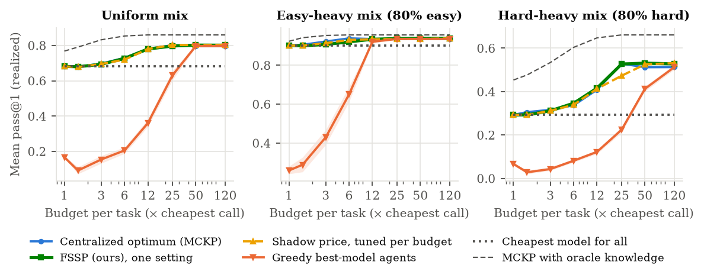

**Fig. F1.** Realized pass@1 vs. budget per task (expected information, 50 test seeds, 95 % CI). FSSP (green, one setting) lies on top of MCKP (blue) at every budget and mix.

**Table F1 - Main comparison** (expected information, full pool, mean over 3 mixes × 8 budgets × 50 test seeds; "tight" = budgets ×1.5, 3, 6; * = re-tuned for every budget).

| Paradigm | Method | Mean Q | Gap % | Gap tight % | Starved % | Jain | Budget used % |
|:---|:---|:---:|:---:|:---:|:---:|:---:|:---:|
| Centralized | **Optimal MCKP** | 0.691 | 0.0 | 0.0 | 0.0 | 0.943 | 84 |
| Centralized | Predictive router | 0.691 | −0.1 | −0.3 | 0.0 | 0.944 | 83 |
| Centralized | Static equal quota | 0.688 | 0.5 | 1.0 | 0.0 | 0.941 | 68 |
| Centralized | Cheapest model | 0.626 | 11.1 | 4.2 | 0.0 | 0.919 | 29 |
| Decentralized | **FSSP (ours), random arrival** | **0.691** | **−0.1** | 0.8 | **0.0** | 0.945 | 67 |
| Decentralized | FSSP (ours), easiest-first | 0.692 | −0.2 | 0.2 | 0.0 | 0.944 | 73 |
| Decentralized | FSSP with α = 0 (fixed price) | 0.678 | 2.6 | 4.9 | 1.5 | 0.940 | 48 |
| Decentralized | Shadow price* | 0.689 | 0.4 | 0.9 | 0.0 | 0.944 | 69 |
| Decentralized | Quasi-linear* | 0.680 | 2.7 | 6.0 | 3.4 | 0.938 | 57 |
| Decentralized | Shapley share* | 0.682 | 2.0 | 4.0 | 1.5 | 0.939 | 54 |
| Decentralized | ΔU/ΔC ratio | 0.515 | 28.1 | 31.4 | 19.9 | 0.872 | 57 |
| Decentralized | Greedy best-model | 0.419 | 45.3 | 71.1 | 45.5 | 0.767 | 84 |

* FSSP vs. greedy: **+27.2 pp** pass@1 (sign-flip p < 5×10⁻⁵). FSSP vs. the per-budget re-tuned shadow price: **+0.23 pp** (p = 1.5×10⁻⁴), although FSSP was tuned once.
* Worst (mix, budget) cell: FSSP **3.9 %** (hard-heavy ×1.5) vs. shadow price* **10.4 %** (hard-heavy ×25).
* Small negative gaps are possible because MCKP is optimal only for the *estimated* q̂.

**Table F2 - Gap to MCKP (%) by budget** (expected information, full pool, random arrival, mean over 3 mixes).

| Budget ×c_min | MCKP Q | FSSP | Shadow price* | Quasi-linear* | Greedy |
|:---:|:---:|:---:|:---:|:---:|:---:|
| 1 | 0.626 | 0.0 | 0.0 | 0.0 | 74.6 |
| 1.5 | 0.630 | 1.5 | 1.6 | 1.9 | 81.7 |
| 3 | 0.645 | 1.1 | 0.7 | 4.4 | 72.5 |
| 6 | 0.669 | −0.3 | 0.4 | 11.8 | 59.3 |
| 12 | 0.708 | −0.6 | −0.4 | 7.4 | 41.8 |
| 25 | 0.755 | 0.2 | 3.5 | −0.4 | 26.2 |
| 50 | 0.748 | −1.6 | −1.1 | −1.7 | 6.4 |
| 120 | 0.749 | −1.3 | −1.6 | −1.6 | 0.0 |

### 3.5 Arrival order: FSSP needs no scheduler

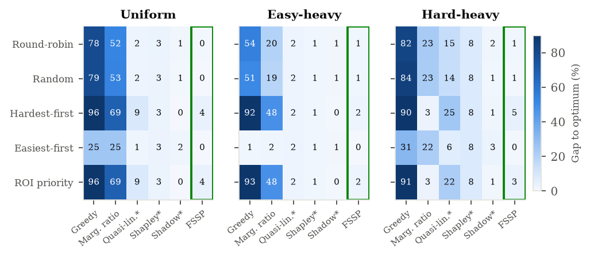

**Fig. F2.** Gap (%) for every arrival order × utility at tight budgets. FSSP (framed) is close to zero for every order and every mix.

**Table F3 - FSSP gap to MCKP (%) by arrival order** (expected information, mean over mixes).

| Arrival order | Needs a coordinator? | Full pool, all budgets | Full pool, tight | Steep pool, all budgets |
|:---|:---:|:---:|:---:|:---:|
| Random | no | −0.1 | 0.8 | −0.5 |
| Round-robin FCFS | no | 0.1 | 1.0 | −0.4 |
| Easiest-first | yes (sees the queue) | −0.2 | 0.2 | −0.5 |
| Hardest-first | yes | 1.4 | 3.5 | 1.0 |
| Marginal-ROI priority | yes | 1.0 | 3.2 | 1.0 |

The orders that need nobody to reorder requests (random, FCFS) are already at the optimum. Easiest-first is marginally better, but it requires a scheduler that sees the whole queue, a form of central control. All FSSP headline numbers therefore use random arrival.

### 3.6 One setting for every budget

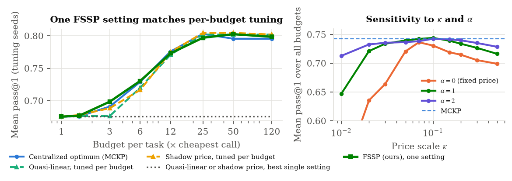

**Fig. F3.** Left (tuning seeds): quasi-linear and shadow price match MCKP only when re-tuned per budget (dashed). Their best single setting (dotted) equals the cheapest-model baseline. FSSP with one setting follows MCKP. Right: FSSP mean Q is flat over a wide κ range for α ≥ 1. The fixed-price variant α = 0 is more sensitive (gap 2.6 %).

### 3.7 Robustness of the single setting

**Table F4** (random arrival; budget ∝ tasks; * = re-tuned per budget).

| Setting | MCKP Q | FSSP Q | FSSP gap % | FSSP+ETF gap % | Shadow price* gap % | Greedy gap % |
|:---|:---:|:---:|:---:|:---:|:---:|:---:|
| Uniform mix | 0.746 | 0.745 | 0.0 | −0.2 | 0.0 | 48.3 |
| Easy-heavy mix | 0.926 | 0.923 | 0.4 | 0.0 | 0.3 | 28.1 |
| Hard-heavy mix | 0.402 | 0.406 | −0.8 | −0.5 | 0.8 | 59.5 |
| Steep pool {v3.1, r1, gemini-pro} | 0.691 | 0.693 | −0.5 | −0.5 | 0.1 | 44.3 |
| Oracle information | 0.791 | 0.778 | 2.2 | 1.4 | 7.5 | 16.6 |
| N = 5 agents (×3, ×12) | 0.670 | 0.664 | 0.6 | 0.1 | 0.3 | 52.5 |
| N = 20 agents (×3, ×12) | 0.676 | 0.674 | 0.1 | −0.3 | 0.1 | 62.1 |
| N = 50 agents (×3, ×12) | 0.676 | 0.673 | 0.3 | −0.1 | 0.2 | 64.7 |
| Correct labels (×3, 12, 50) | 0.758 | 0.759 | 0.0 | 0.0 | −0.1 | 43.9 |
| Noisy labels ε = 0.2 | 0.748 | 0.749 | −0.2 | 0.0 | −0.2 | 43.0 |
| Noisy labels ε = 0.4 | 0.738 | 0.740 | −0.1 | −0.1 | −0.2 | 43.1 |

* Within ~1 % of the optimum in every mix, in the steep pool, for 5–50 agents and with 20–40 % wrong difficulty labels. Label noise lowers MCKP and FSSP by the same amount, so the gap does not grow.
* The largest gap is with oracle information (2.2 % mean, worst cell 19.3 % at hard-heavy ×1). With true outcomes known, the planner can match each hard task to the one model that solves it across the batch, which a sequential agent cannot do. The re-tuned shadow price is much worse here (7.5 %).

### 3.8 When the number of requests is unknown

**Table F5** (uniform/easy-heavy/hard-heavy × 8 budgets × 50 test seeds, random arrival; online = rate-based estimate of §3.2).

| How agents get R̂_k | Mean Q | Gap % | Gap tight % | Worst cell % | Starved % | Budget used % |
|:---|:---:|:---:|:---:|:---:|:---:|:---:|
| MCKP (reference) | 0.691 | 0.0 | 0.0 | 0.0 | 0.0 | 84 |
| True n known: n − k | 0.691 | −0.1 | 0.8 | 3.9 | 0.0 | 67 |
| **Online, no prior** | **0.690** | **0.1** | 0.9 | 3.9 | 0.1 | 65 |
| Online, wrong prior n₀ = 0.5n | 0.691 | 0.0 | 0.9 | 4.2 | 0.2 | 66 |
| Online, wrong prior n₀ = 2n | 0.689 | 0.2 | 1.0 | 3.7 | 0.0 | 64 |
| Fixed forecast 1.25n | 0.684 | 1.3 | 3.5 | 8.2 | 0.0 | 52 |
| Fixed forecast 1.5n | 0.680 | 2.1 | 4.4 | 11.3 | 0.0 | 46 |
| Fixed forecast 2n | 0.671 | 3.7 | 4.8 | 23.4 | 0.0 | 40 |
| Fixed forecast 0.75n | 0.671 | 3.5 | 6.2 | 17.7 | 4.6 | 76 |
| Fixed forecast 0.5n | 0.597 | 15.9 | 26.8 | 39.4 | 17.7 | 80 |
| Greedy best-model | 0.419 | 45.3 | 71.1 | 90.4 | 45.5 | 84 |

* **Re-estimating the demand online is as good as knowing n.** Even a prior that is off by 2× is corrected within the period.
* A **fixed** wrong forecast is harmful, and asymmetrically so. Overestimating makes agents too frugal and leaves money unspent, but nobody starves. Underestimating drives the price to zero once the forecast is used up (R̂_k = 1, so the agent "owns" the whole remaining budget), and late requests starve. When unsure, overestimate.

### 3.9 Fairness and first-mover advantage

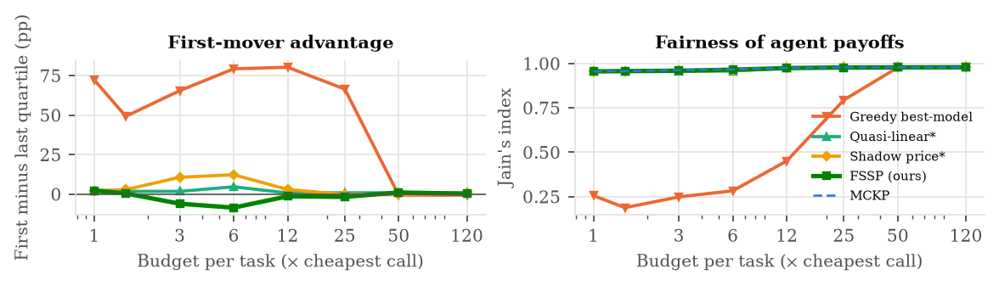

**Fig. F4.** Agents arrive in random order and submit all 10 tasks at once (uniform mix).

At tight budgets, greedy agents give the first quarter of agents **64.7 pp** more pass@1 than the last quarter (Jain 0.24). The re-tuned shadow price keeps a first-mover premium of 8.6 pp. With FSSP the difference is **−4.7 pp**: late agents do slightly better, because money left unspent by early agents raises the later fair share and lowers the price. FSSP's Jain index is 0.96, the same as MCKP's (0.96).

### 3.10 Verdict

FSSP is the decentralized method we recommend. It is a one-line utility with one parameter setting, it needs no scheduler and no knowledge of other agents' tasks, and it does not need the total number of requests. It matches the exact centralized optimum on held-out data, never starves a task in the realistic setting, and is as fair as the central planner. Centralization keeps an edge only through extra information (oracle outcomes, or the test feedback used by the cascade).

---

## 4. Hypothesis-by-hypothesis verdicts

| # | Hypothesis (from the proposal) | Verdict |
|---|---|---|
| H1 | A price of anarchy exists, and it grows as the budget tightens | **Supported for naive agents; largely removable** |
| H2 | More agents means more contention and a larger gap | **Partially supported.** Only for scarcity-blind utilities, and it is a budget-granularity effect |
| H3 | HTF / marginal-ROI ordering closes the gap; ETF is the worst case | **Rejected (reversed).** ETF is best; HTF and ROI-priority are worse than random |
| H4 | Scarcity-aware utilities (shadow price, Shapley, ΔU/ΔC) beat quasi-linear / best-model | **Supported for shadow price (and Shapley); not for ΔU/ΔC.** Calibration is essential |
| H5 | Expensive models are worth more on hard tasks | **Supported**, but "expensive" ≠ "best" |
| H6 | Random arrival produces a first-mover advantage and starvation | **Supported for naive agents; eliminated by calibrated utilities** |
| H7 | A steep cost/quality gap hurts decentralized agents more | **Supported** |

### H1 - Price of anarchy vs. budget pressure

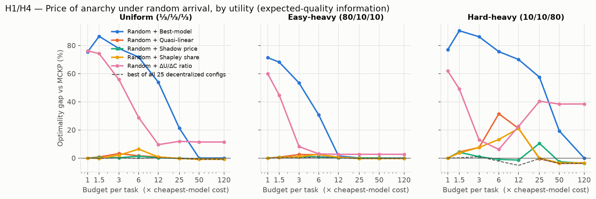

**Fig. 2.** Gap to MCKP under random arrival for each utility (expected information). The dashed line is the best of all 25 decentralized configurations.

* **Naive agents (random arrival + best-model)** lose **72–86 %** (uniform), **31–68 %** (easy-heavy) and **76–90 %** (hard-heavy) at budgets of ×1–6. The gap falls to 0 only once the budget covers gemini-2.5-pro for everyone (×50–120). Early agents buy gemini-2.5-pro ($0.135, i.e. 120 cheapest calls) for tasks that $0.001 would have solved, and 45 % of tasks end up with no model at all.
* The gap shrinks monotonically as budget grows (Fig. 2), so the "grows as the budget tightens" part holds. The exception is ×1, where the most anyone can afford is the cheapest model for everyone.
* **But it is mostly a price of miscalibration, not of decentralization.** The same agents with a calibrated shadow-price utility have a mean gap of 0.4 % overall and ≤ 2.1 % in every (mix × tight/loose) regime (Table 4). Their single worst (mix, budget) cell is 10.4 % (hard-heavy ×25), where parameters calibrated on the uniform mix transfer imperfectly.
* **With oracle information the residual gap is larger** (Fig. 2b, Table 3). At ×1–3 on hard-heavy work even the best decentralized configuration is 10–15 % behind. When per-task outcomes are known, the central planner can solve the global matching of "which hard task is solvable by which model" ahead of time. A myopic sequential agent can't, because it may have to commit budget before the tasks that would use it better have arrived. This is the part of the PoA that coordination actually buys.

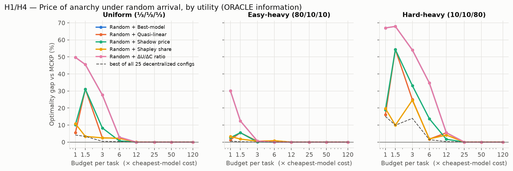

**Fig. 2b.** Same as Fig. 2 with oracle information. Best-model and ΔU/ΔC coincide here and overlap on the plot. Utility parameters were calibrated in the expected setting.

**Table 3 - Value of information (best decentralized vs. MCKP).**

| Mix | Budget ×c_min | MCKP Q (expected) | Best dec. gap % (expected) | MCKP Q (oracle) | Best dec. gap % (oracle) |
|:---|:---:|:---:|:---:|:---:|:---:|
| uniform | 3 | 0.697 | 0.0 | 0.832 | 0.5 |
| uniform | 12 | 0.781 | 0.2 | 0.860 | 0.0 |
| easy-heavy | 3 | 0.923 | 0.1 | 0.954 | 0.0 |
| hard-heavy | 3 | 0.316 | 1.3 | 0.534 | **13.9** |
| hard-heavy | 12 | 0.409 | −4.7 | 0.648 | 0.3 |
| hard-heavy | 50 | 0.512 | −3.7 | 0.661 | 0.0 |

Knowing per-task outcomes is worth +3 to +24 pp of quality (MCKP oracle vs. expected; largest on hard-heavy work), far more than coordination is worth once agents are calibrated. A practical corollary is the cascade†, which buys some of that information by running tests: it beats expected-information MCKP by 7 % on average (Table 1).

### H2 - Number of agents

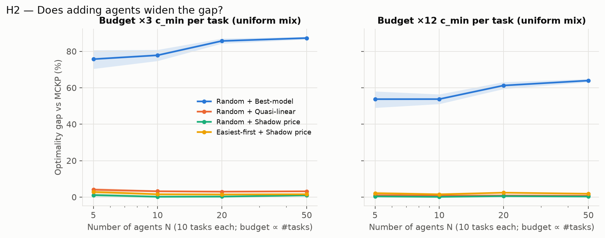

**Fig. 4.** Gap vs. N with 10 tasks per agent and budget ∝ #tasks.

**Table 5 - Gap (%) vs. N, uniform mix.** Full table across mixes: `results/hypotheses/report_tables.md` (t_scale).

| Policy | Budget | N=5 | N=10 | N=20 | N=50 |
|:---|:---:|:---:|:---:|:---:|:---:|
| Random + Best-model | ×3 | 75.7 | 77.8 | 85.7 | 87.3 |
| Random + ΔU/ΔC | ×3 | 53.4 | 55.8 | 62.9 | 65.3 |
| Random + Quasi-linear | ×3 | 4.1 | 3.2 | 3.0 | 3.2 |
| Random + Shadow price | ×3 | 1.1 | 0.2 | 0.3 | 0.9 |
| Random + Best-model | ×12 | 53.7 | 53.8 | 61.2 | 63.9 |
| Random + Shadow price | ×12 | 0.4 | 0.1 | 0.5 | 0.3 |

* Averaged over all 25 decentralized configurations, the gap rises by +2 to +7 pp from N=5 to N=50 in 5 of 6 (mix, budget) cells (paired sign-flip test, p < 0.003). Easy-heavy at ×12 goes the other way (−1.3 pp).
* The increase comes **entirely from the scarcity-blind utilities** (best-model, ΔU/ΔC). Calibrated quasi-linear / shadow-price / Shapley stay flat. MCKP quality is flat in N.
* **Mechanism.** In this game an agent is only a bundle of tasks, so N matters only through the total number of tasks drawing on B. With few tasks, the leftover budget below one premium call ($0.135) is a large share of B, and greedy agents spend it on cheaper models and serve extra tasks. As N grows, that leftover becomes negligible and the gap converges to its asymptote (~87 % at ×3). So the effect is real but it is budget granularity, not strategic contention between agents. **Verdict: partially supported.**

### H3 - Arrival ordering

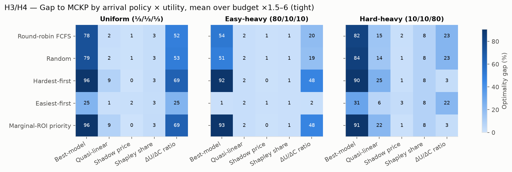

**Fig. 3.** Gap to MCKP (%) for every arrival × utility pair, mean over tight budgets (×1.5–6). For the mean over all budgets see `figures/fig3_arrival_utility_heatmap_all.png`.

**Table 6 - Gap (%) by arrival order, averaged over the 5 utilities.** The last two columns are paired differences vs. random arrival over 150 (seed × budget) pairs, with sign-flip permutation p-values.

| Mix | Budget | FCFS | Random | HTF | ETF | ROI-priority | HTF − Random | ETF − Random |
|:---|:---|:---:|:---:|:---:|:---:|:---:|:---:|:---:|
| uniform | tight (×1.5–6) | 27.3 | 27.3 | 35.2 | **11.2** | 35.3 | +7.9 pp, p<10⁻⁴ | **−16.1 pp**, p<10⁻⁴ |
| uniform | loose (×12–50) | 7.2 | 7.1 | 13.2 | **3.3** | 13.3 | +6.1 pp, p<10⁻⁴ | −3.8 pp, p<10⁻⁴ |
| easy-heavy | tight | 15.6 | 14.6 | 28.7 | **1.4** | 28.9 | +14.1 pp, p<10⁻⁴ | −13.3 pp, p<10⁻⁴ |
| easy-heavy | loose | 0.6 | 0.6 | 2.1 | **0.5** | 2.1 | +1.4 pp, p<10⁻⁴ | −0.1 pp, p<10⁻⁴ |
| hard-heavy | tight | 25.9 | 26.1 | 25.3 | **14.2** | 24.8 | −0.8 pp, p=0.20 | −12.0 pp, p<10⁻⁴ |
| hard-heavy | loose | 19.7 | 19.2 | 26.6 | **13.1** | 26.4 | +7.4 pp, p<10⁻⁴ | −6.1 pp, p<10⁻⁴ |

**Verdict: rejected, and reversed.** Easiest-first is the best ordering in every cell, and hardest-first / marginal-ROI priority are worse than random. Why:

* A starved task scores 0, but an easy task is solved with certainty by *every* model, including the $0.001 one. Serving easy tasks first guarantees a full point per $0.001 before budget runs out. That is the value-density greedy that approximates a knapsack.
* HTF hands the budget first to the tasks where a dollar buys the *least* expected quality (hard tier: at best 0.43 pass rate even with frontier models). Easy and medium tasks that arrive later then starve.
* Marginal-ROI priority ranks by the *upgrade* ratio (q_m − q_cheapest)/(c_m − c_cheapest). That ratio is 0 for easy tasks because the cheap model already solves them, so they go last. This is the same error as HTF. The priority that works is *value of being served per dollar*, not upgrade ROI.
* Ordering matters little once the utility is scarcity-aware: with shadow price, every ordering is within 0–3 % (Fig. 3, column 3).

### H4 - Utility design

**Table 4 - Gap (%) by utility under random arrival.** In parentheses: the paired difference vs. best-model; * means p < 0.01.

| Mix | Budget | Best-model | Quasi-linear | Shadow price | Shapley share | ΔU/ΔC ratio |
|:---|:---|:---:|:---:|:---:|:---:|:---:|
| uniform | tight | 78.7 | 1.8 (−76.8*) | **0.6** (−78.0*) | 2.7 (−76.0*) | 52.9 (−25.8*) |
| uniform | loose | 25.0 | −0.1 (−25.1*) | **−0.2** (−25.2*) | −0.1 (−25.1*) | 10.9 (−14.1*) |
| easy-heavy | tight | 50.7 | 1.8 (−48.9*) | **0.7** (−50.0*) | 1.3 (−49.4*) | 18.6 (−32.1*) |
| easy-heavy | loose | 0.5 | 0.0 (−0.5*) | 0.1 (−0.4) | 0.0 (−0.5*) | 2.6 (+2.1*) |
| hard-heavy | tight | 84.1 | 14.4 (−69.6*) | **1.4** (−82.7*) | 8.1 (−76.0*) | 22.7 (−61.4*) |
| hard-heavy | loose | 48.9 | 5.6 (−43.3*) | **2.1** (−46.8*) | 5.8 (−43.1*) | 33.7 (−15.2*) |

* **Dynamic shadow price is the best and most consistent utility**: at most 2.1 % gap in every regime. Its edge is largest on hard-heavy work, where the payoff from frontier models is high but uncertain and a fixed λ either over- or under-spends. The rising price p(B_k) = p₀(B/B_k)^α makes later agents progressively thriftier, so the budget is not exhausted before late tasks are served.
* Shapley share and quasi-linear are close behind (≤ 14 %). Shapley behaves like a rescaled quasi-linear here: its calibrated λ is 5–40× larger, absorbing the 1/(1+γφᵢ) factor.
* **ΔU/ΔC ratio fails (11–53 % gap).** Its utility is 0 for the cheapest model and positive for any upgrade, so an agent upgrades whenever it can afford to, regardless of how much budget the others still need. It is effectively budget-blind.

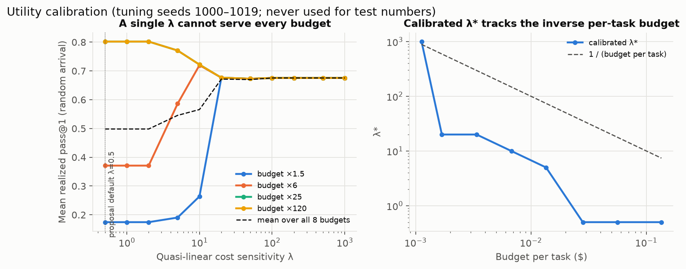

**Fig. 8.** Left: quasi-linear quality vs. λ at four budgets (tuning seeds). Right: the calibrated λ* falls in parallel with 1/(budget per task). For budgets ×3–12, λ* × (B/#tasks) = 0.068 exactly.

**Table 8 - How much the calibration matters** (tuning seeds, full pool, random arrival).

| Utility | Q, calibrated per budget | Q, best single setting for all budgets | Regret, params taken from a budget ×2 away | Regret, params taken from any other budget | Worst-case regret |
|:---|:---:|:---:|:---:|:---:|:---:|
| Quasi-linear | 0.741 | 0.675 | 0.051 | 0.186 | 0.510 |
| Shadow price | 0.743 | 0.675 | 0.055 | 0.174 | 0.555 |
| Shapley share | 0.737 | 0.675 | 0.041 | 0.179 | 0.510 |

**Important qualification.** With the proposal's default parameters, every utility reduces to best-model. With a single parameter shared across all budgets, every utility's optimum is "always buy the cheapest model" (Q = 0.675, the cheapest-model baseline), because any willingness to upgrade starves tasks at tight budgets. The shadow price's built-in scarcity adaptation does **not** remove the need to calibrate p₀ to the budget scale: its regret under mis-calibration is about the same as quasi-linear's. The practical rule from Fig. 8 is to **set the cost weight to λ ≈ 0.07 / (B/#tasks)**, i.e. measure cost in units of each agent's fair share of the budget. (At ×1 the right choice is to never upgrade; above ×25 any small λ works.) **Verdict: supported for shadow price (and Shapley), conditional on calibration; not supported for ΔU/ΔC.**

### H5 - Value of expensive models by difficulty

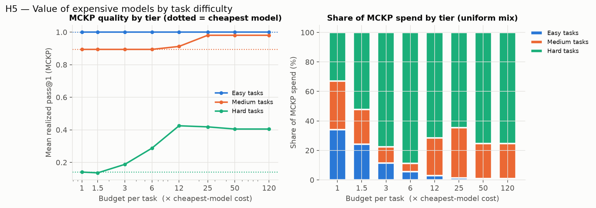

**Fig. 5.** Left: MCKP's realized pass@1 per tier vs. budget (dotted = cheapest model). Right: share of MCKP's spend going to each tier.

**Table 7 - Per-tier pass@1 of each model (all 1,055 tasks).**

| Model | $/call | easy | medium | hard | Δ hard vs. cheapest | Δ hard per extra $ |
|:---|:---:|:---:|:---:|:---:|:---:|:---:|
| deepseek-v3.1-terminus | 0.0011 | 1.000 | 0.884 | 0.136 | - | - |
| deepseek-v3-0324 | 0.0014 | 1.000 | 0.852 | 0.148 | +0.011 | 35.3 |
| gemini-2.5-flash | 0.0058 | 1.000 | 0.736 | 0.065 | −0.071 | < 0 |
| claude-sonnet-4 | 0.0135 | 1.000 | 0.685 | 0.060 | −0.077 | < 0 |
| deepseek-r1-0528 | 0.0289 | 1.000 | **0.977** | 0.426 | **+0.290** | **10.4** |
| gemini-2.5-pro | 0.1352 | 1.000 | 0.940 | **0.435** | +0.298 | 2.2 |

**Verdict: supported.**

* On easy tasks an expensive model is worth exactly 0, since every model passes all of them.
* On medium tasks r1 adds +9 pp. On hard tasks r1 or pro add +29–30 pp, tripling the pass rate.
* As the budget grows, MCKP moves from ~⅓ of spend on each tier to ~75 % on hard tasks and ~0 % on easy ones (Fig. 5, right).
* **"Expensive" is not "better."** Gemini-2.5-flash and claude-sonnet-4 are *dominated* by the cheapest model on this benchmark. Gemini-2.5-pro costs 4.7× deepseek-r1 for +0.9 pp on hard tasks and −3.7 pp on medium. The only purchase worth making is r1 on medium and hard tasks.
* Caveat: the tiers are defined from model outcomes (easy = "all models pass"; see §5), which makes the easy-tier effect sharper than a real difficulty classifier would.

### H6 - First-mover advantage and starvation

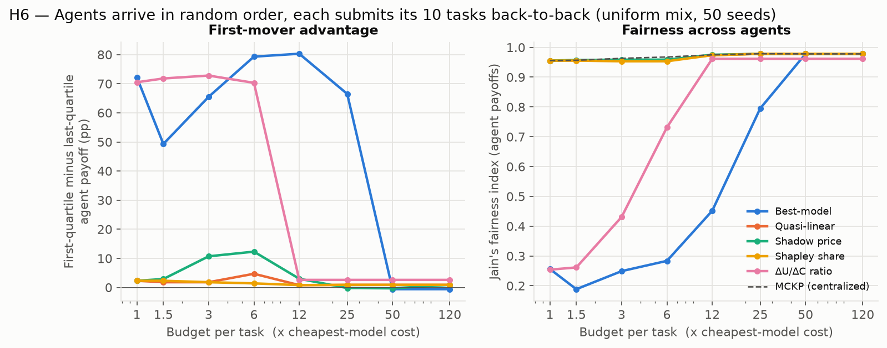

**Fig. 6b.** Agents arrive in random order and each submits all 10 tasks back-to-back. Left: payoff gap between the first and last quartile of agents. Right: Jain's fairness index.

**Table 9 - Agent-level first-mover effects (uniform mix, random agent order).**

| Utility | Budget ×c_min | First − last quartile payoff (pp) | Runs with last quartile at 0 | Agent starve % | Jain | Gap % |
|:---|:---:|:---:|:---:|:---:|:---:|:---:|
| Best-model | 3 | **65.5** | 100 % | 77.2 | 0.25 | 74.1 |
| Best-model | 6 | **79.3** | 100 % | 74.0 | 0.28 | 70.3 |
| Best-model | 25 | 66.5 | 38 % | 24.0 | 0.80 | 21.6 |
| ΔU/ΔC ratio | 3 | 72.8 | 100 % | 65.0 | 0.43 | 56.0 |
| Shadow price | 3 | 10.7 | 0 % | 0.0 | 0.96 | 0.4 |
| Shadow price | 6 | 12.3 | 0 % | 0.0 | 0.96 | 1.3 |
| Quasi-linear | 6 | 4.7 | 4 % | 1.0 | 0.96 | 1.3 |
| Shapley share | 6 | 1.4 | 0 % | 0.0 | 0.95 | 6.3 |

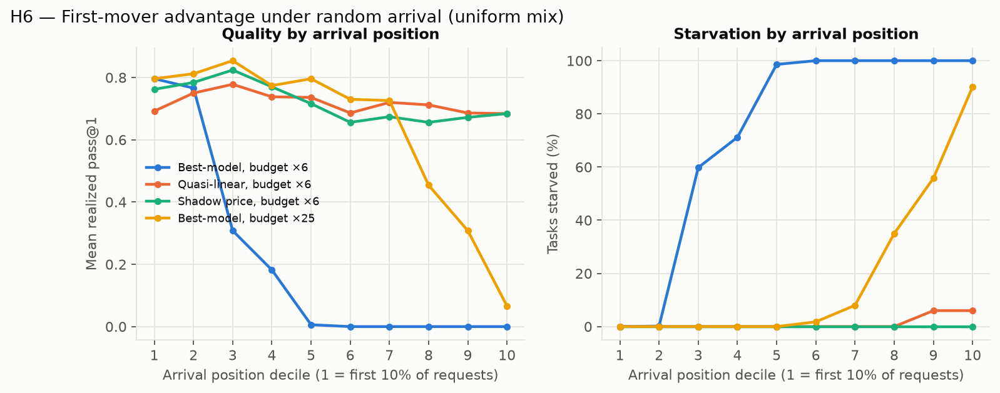

**Fig. 6.** Job-level view under random per-request arrival: realized quality and starvation by arrival decile.

**Verdict: supported for naive agents, and eliminated by calibrated utilities.**

* With best-model, the first quarter of agents get 49–80 pp more quality than the last quarter, the last quarter is completely starved in 100 % of runs at tight budgets, and Jain's index falls to 0.19–0.28. Per request, the last decile is 100 % starved at budgets ×3 and ×6 (Fig. 6).
* Calibrated quasi-linear and Shapley utilities remove the effect (≤ 5 pp, Jain ≈ 0.96, the same as MCKP).
* The shadow price keeps a **moderate** first-mover premium (11–12 pp at ×3–6). This is built into the design: the price is low while the pool is full, so early agents upgrade more cheaply. It costs no starvation and almost no welfare (gap ≤ 1.3 %).

### H7 - Cost/performance disparity

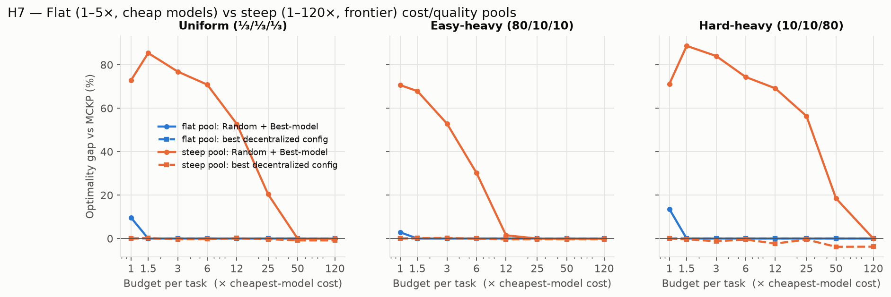

**Fig. 7.** Gap vs. budget for a *flat* pool {v3.1-terminus, v3-0324, flash} (1–5.2× cost) and a *steep* pool {v3.1-terminus, r1, pro} (1–120× cost). Utilities were re-calibrated for each pool.

| Mix | Pool | Naive gap %, tight | Mean decentralized gap %, tight | Mean decentralized gap %, loose | Best decentralized gap %, tight |
|:---|:---:|:---:|:---:|:---:|:---:|
| uniform | flat | 0.0 | 0.0 | 0.0 | 0.0 |
| uniform | steep | 77.7 | 29.3 | 7.9 | −0.1 |
| easy-heavy | steep | 50.3 | 19.3 | 0.6 | 0.2 |
| hard-heavy | flat | 0.0 | 0.0 | 0.0 | 0.0 |
| hard-heavy | steep | 82.4 | 29.3 | 15.3 | −0.7 |

**Verdict: supported.**

* In the flat pool decentralization costs nothing. The only gap is 3–13 % at k = 1, from naive agents buying flash (5×).
* In the steep pool naive agents lose 50–82 % and the average decentralized design loses 19–29 % at tight budgets.
* The steeper the price ladder, the more one greedy purchase displaces other agents (one gemini-pro call = 120 cheapest calls), so local decisions carry larger externalities.
* Caveat: in the real flat pool the cheapest model also has the highest quality, so there is little to decide. The flat result is partly a statement about this benchmark.

### Robustness: noisy difficulty labels

The agents' tier label was replaced by a random different tier with probability ε (uniform mix).

| ε | Budget | MCKP Q | Naive Q | ETF+Shadow Q | Best decentralized Q (config) |
|:---:|:---:|:---:|:---:|:---:|:---|
| 0.0 | ×3 | 0.697 | 0.155 | 0.686 | 0.697 (HTF+Shadow) |
| 0.2 | ×12 | 0.766 | 0.355 | 0.759 | 0.762 (Random+Shadow) |
| 0.4 | ×3 | 0.688 | 0.176 | 0.682 | 0.691 (ROI-prio+Shadow) |
| 0.4 | ×12 | 0.753 | 0.341 | 0.747 | 0.748 (FCFS+Shadow) |

Noise lowers *everyone's* quality by up to ~3 pp, centralized included. The best decentralized configuration stays within 0.7 % of MCKP at every noise level. The conclusions don't depend on perfect difficulty labels.

---

## 5. Caveats

1. **Difficulty labels come from outcomes.** The dataset's tiers are tertiles of mean pass rate across the six models, so "easy" means all six passed. Agents in the expected setting see the tier, which is a stronger signal than a real difficulty classifier would give. The label-noise test (ε up to 0.4) shows the centralized-vs-decentralized conclusion is robust, but absolute qualities are optimistic.
2. **Cost per call is each model's mean cost**, not per-task token cost, as in the original pipeline.
3. **The baseline utilities need per-budget calibration.** Someone has to set λ ≈ 0.07/(B/#tasks) for each budget. Without it (§H4), they either behave greedily (default λ) or collapse to the cheapest model (one λ for all budgets). FSSP removes this need (§3.6), but it needs an estimate of the remaining demand. The online estimator of §3.2 assumes a roughly constant arrival rate over the budget period; bursty or seasonal traffic would need a better forecast.
4. **Oracle-setting utilities use the expected-setting calibration.** Oracle decentralized gaps may be slightly pessimistic.
5. **The confidence cascade** gets test feedback (realized outcomes) in both settings, so it is not directly comparable with the other planners.
6. **Exact MCKP is solved over groups of identical jobs.** The repo's 0/1 MCKP formulation stalled in SCIP on the symmetric expected-information instances (all tasks in a tier share one q̂ vector). The harness solves the equivalent integer program over per-group counts. It gives the identical objective (verified on 60 instances, max difference 0) in < 0.25 s. The repo code itself is unchanged.
7. Budget feasibility was checked on every run. The repo policies' 10⁻⁹ per-step tolerances can accumulate to a relative overshoot of < 10⁻⁶.

---

## 6. Conclusion

1. **The price of anarchy is real but is mostly a price of naive incentives.** Uncoordinated agents that maximize their own quality waste 50–90 % of achievable quality under budget pressure, starve late agents completely, and produce severe positional unfairness (H1, H6 confirmed).
2. **Decentralized orchestration can match the centralized optimum.** Each agent needs a scarcity-aware utility q − p·c whose price is measured in units of the per-task fair share, ideally a dynamic shadow price that rises as the shared pool depletes. The best such configuration is within **0–3 %** of the exact MCKP solution in every mix and budget; random arrival + shadow price alone averages 0.4 %. Both come with zero starvation and centralized-level fairness (H4). The marginal-ROI ratio utility proposed as a submodular surrogate does not achieve this.
3. **Ordering matters less than utility, and the intuitive ordering is wrong.** Serving cheap, certain wins first (easiest-first) is best. Prioritizing hard or high-upgrade-ROI tasks is worse than random (H3 reversed), because a starved task loses everything while an upgrade gains only a fraction.
4. **Centralization still pays in two situations:** (a) when the planner has per-task information the agents lack (oracle: up to 14 % gap on hard-heavy work at tight budgets), and (b) when verification feedback is available (the test-driven cascade beats every planner by ~7 %). In both cases information, not coordination, is the bottleneck.
5. **The problem's difficulty is driven by the cost ladder and the per-task budget, not by the number of agents.** Steep price ladders magnify the externality of each greedy choice (H7). Adding agents only widens the gap for scarcity-blind agents, through budget granularity (H2 partial). Expensive models are worth buying only for medium and hard tasks, and on this benchmark only deepseek-r1 is worth its price (H5).

6. **Points 2–3 lead to a new utility, FSSP (§3), which closes the gap without per-budget tuning.** It prices money by the inverse of the remaining budget per request still to come. With one setting (κ = 0.1) it matches MCKP on held-out seeds (gap −0.1 %), beats even the per-budget re-tuned shadow price (+0.23 pp, worst cell 3.9 % vs. 10.4 %), removes the first-mover advantage, and works without knowing the total number of requests (online estimate: 0.1 % gap).

**Recommendation for a decentralized orchestrator:** use **FSSP** (§3.2). Each agent, when its request arrives:
1. reads the remaining budget B_k and the request count k from the shared ledger;
2. estimates the requests still to come, R̂_k = n − k if n is known, otherwise R̂_k = 1 + r̂(1 − t) with r̂ = (k + 1)/t the arrival rate so far in the budget period;
3. picks argmax q̂_m − κ·(R̂_k/B_k)·c_m over the affordable models, with κ = 0.1.

No central solver, scheduler or per-budget tuning is needed. If the demand forecast is uncertain, err on the high side.

(The earlier recommendation, a dynamic shadow price p₀(B/B_k)^α with p₀ re-calibrated for each budget level, also works, with a 0.4 % mean gap. However, it needs that calibration, has a 10.4 % worst cell and keeps a first-mover premium.)

---

## 7. Reproduction

```bash
# 1. design-space study: tune baseline utilities (tuning seeds), then every test stage  (~1 h on 12 cores)
python scripts/hypotheses/run_all.py tune main scale disparity noise
python scripts/hypotheses/burst_stage.py          # H6 agent-level arrival
# 2. FSSP: pick one (kappa, alpha) on tuning seeds, then test it
python scripts/hypotheses/fssp_stage.py tune test scale
python scripts/hypotheses/fssp_extra.py noise burst
python scripts/hypotheses/fssp_unknown_n.py       # n unknown: online estimate vs. wrong forecasts
# 3. figures + tables
python scripts/hypotheses/make_figures.py         # -> figures/*.png, results/hypotheses/report_tables.md
python scripts/hypotheses/paper_figures.py        # -> figures/paper/*.png, report/generated/*.tex (FSSP tables)
```

* Raw per-run results: `results/hypotheses/*.csv.gz` (one row per instance × policy)
* Calibrated parameters: `results/hypotheses/tuned_params.json` (baselines), `results/hypotheses/fssp_params.json` (FSSP)
* Harness (information models, rescoring, grouped MCKP): `scripts/hypotheses/harness.py`

---

## Appendix A - Earlier results (superseded)

The previous version of this file reported the numbers below. They were superseded for three reasons. First, every policy, including the decentralized agents, read the realized per-task pass/fail (oracle information). Second, each difficulty mix was paired with a *different* decentralized mechanism and budget, so the rows are not comparable. Third, only 5 seeds were used, and utilities ran with defaults (λ = 0.5, p₀ = 0.1) that make them behave like best-model.

| Mix | Budget | Centralized MCKP Q | Decentralized config | Decentralized Q | Reported gap |
|:---|:---:|:---:|:---|:---:|:---:|
| Uniform | $0.289 | 0.755 | Random FCFS + Dynamic shadow price | 0.334 ± 0.088 | 55.8 % |
| Easy-heavy (80/10/10) | $0.289 | 0.950 | ETF + Quasi-linear (λ=0.5) | 0.950 | 0.0 % |
| Hard-heavy (10/10/80) | $1.167 | 0.615 | HTF + Dynamic shadow price | 0.240 | 61.0 % |

The direction of the old findings partly survives: ETF was already doing well, and naive decentralized play loses about 55–60 %. Their interpretation does not. The large gaps came from un-calibrated utilities, not from decentralization itself, and the 0 % easy-heavy result came from ETF ordering, not from quasi-linear utility.
